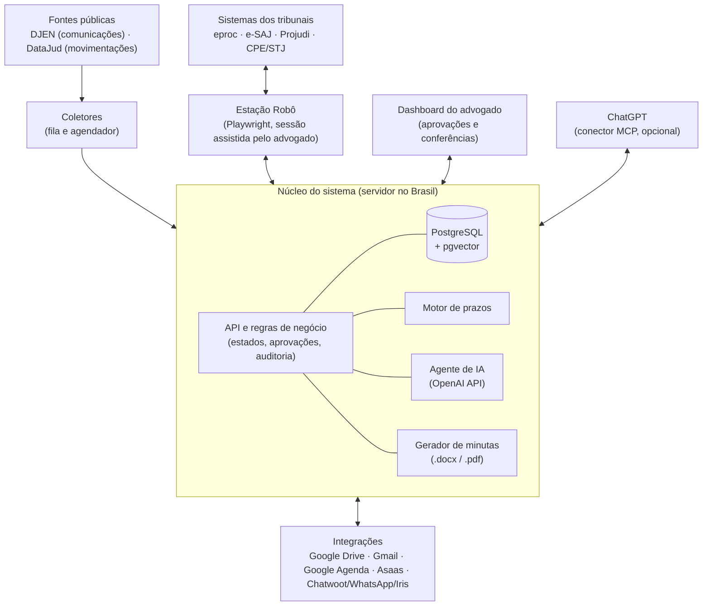
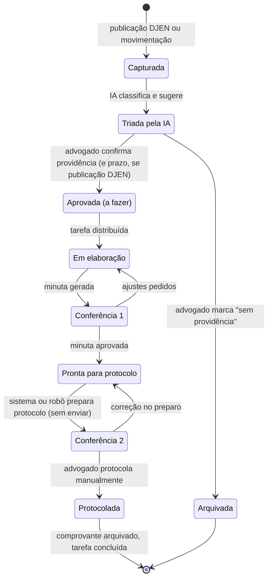

# Plano de Implementação: Sistema de Gestão Jurídica com Agente de IA

| Item | Conteúdo |
|---|---|
| Titular | Samuel Guimarães, OAB/RS 107.046 |
| Versão | 1.1 (revisão de consistência; ver Seção 22) |
| Data | 10/10/2026 |
| Escopo | Sistema independente de gestão jurídica, com agente de IA (OpenAI/ChatGPT), Google Drive, Gmail, robôs de navegação nos sistemas dos tribunais, DJEN, DataJud, Asaas, Chatwoot e atendente virtual Iris |
| Situação | Plano funcional; nenhuma linha de código do sistema foi escrita |

Legenda de rótulos: **[FONTE]** norma ou documentação conferida por leitura integral na fonte oficial (nenhum item desta versão atinge esse grau, pela razão exposta na nota de método); **[CONFERIR]** dado extraído de fonte oficial apenas por trecho indexado, pendente de leitura integral; **[INTERPRETAÇÃO]** leitura técnica; **[HIPÓTESE]** estimativa ou suposição; **[RISCO]** risco operacional ou processual.

> Nota de método. Nesta sessão, a política de rede do ambiente de execução bloqueou a abertura direta das páginas do CNJ, do Planalto, dos tribunais e dos fornecedores (Asaas, Chatwoot, Google, OpenAI). As informações foram obtidas por buscador restrito aos domínios oficiais, com leitura dos trechos indexados. Por isso, todo dado normativo ou técnico externo está rotulado como **[CONFERIR]**, com o link oficial correspondente, e deve ser lido na íntegra antes da codificação do módulo respectivo (tarefa prevista na Fase 0).

---

## Sumário

1. [Sumário executivo](#1-sumário-executivo)
2. [Leitura da imagem e do áudio: requisitos](#2-leitura-da-imagem-e-do-áudio-requisitos)
3. [Princípios de projeto](#3-princípios-de-projeto)
4. [Arquitetura](#4-arquitetura)
5. [Fontes de dados processuais](#5-fontes-de-dados-processuais)
6. [Fluxo operacional: do DJEN ao protocolo manual](#6-fluxo-operacional-do-djen-ao-protocolo-manual)
7. [Motor de prazos](#7-motor-de-prazos)
8. [Robôs dos sistemas dos tribunais](#8-robôs-dos-sistemas-dos-tribunais)
9. [Minutas no padrão do escritório](#9-minutas-no-padrão-do-escritório)
10. [Google Drive e Gmail](#10-google-drive-e-gmail)
11. [Financeiro: Asaas](#11-financeiro-asaas)
12. [Atendimento: Chatwoot, WhatsApp e Iris](#12-atendimento-chatwoot-whatsapp-e-iris)
13. [Papel das ferramentas OpenAI/ChatGPT](#13-papel-das-ferramentas-openaichatgpt)
14. [Dashboard do advogado](#14-dashboard-do-advogado)
15. [Modelo de dados](#15-modelo-de-dados)
16. [Infraestrutura e stack](#16-infraestrutura-e-stack)
17. [Segurança e sigilo](#17-segurança-e-sigilo)
18. [Roteiro de implementação por fases](#18-roteiro-de-implementação-por-fases)
19. [Riscos e mitigação](#19-riscos-e-mitigação)
20. [Decisões pendentes do titular](#20-decisões-pendentes-do-titular)
21. [Fontes consultadas](#21-fontes-consultadas)
22. [Histórico de revisões](#22-histórico-de-revisões)

---

## 1. Sumário executivo

O sistema proposto é uma aplicação web própria (núcleo + banco de dados + dashboard), que usa a API da OpenAI como motor de linguagem e integra Google Drive, Gmail, Google Agenda, Asaas e Chatwoot. Os robôs de navegação nos tribunais são roteiros determinísticos (Playwright), e não um agente de IA navegando livremente.

Conclusões de viabilidade:

1. **Viável e prioritário (MVP):** cadastro de clientes, casos e processos; captura de publicações no DJEN e de movimentações no DataJud; triagem com IA; motor de prazos; tarefas; notificação do advogado por e-mail e no dashboard. Esse bloco usa APIs públicas, com uma condição: a rota pública de consulta do DJEN ainda precisa ser confirmada em fonte oficial (Seção 5.1, com contingência). **[HIPÓTESE]** O fluxo "DJEN à tarefa" da imagem fica funcional ao fim da semana 9 e passa a controle principal de prazos após 30 dias de período sombra, por volta da semana 13 (Seção 18). Duração total estimada: 29 semanas com um desenvolvedor ou 24 semanas com dois.
2. **Viável com engenharia cuidadosa:** minutas automáticas no padrão do escritório, a partir de modelos `.docx` com estilos fixos, conteúdo redigido pela IA e conferência obrigatória do advogado.
3. **Viável, com limitações por tribunal:** robôs para baixar autos e deixar o protocolo preparado sem enviar. Não foi localizada API oficial de download de autos para advogados; a automação depende da interface web de cada sistema (eproc, e-SAJ, Projudi, CPE do STJ). Dois achados tornam o requisito "coloca no protocolo, mas não protocola" tecnicamente limpo: o eproc tem a função "Preparar Movimentação" e o e-SAJ, "Salvar para protocolar depois", ambas descritas nos manuais oficiais como rascunho pendente no painel do advogado, sem protocolo (Seção 8.5). Em contrapartida, a maior parte dos sistemas já exige segundo fator de autenticação, e o CNJ caminha para a generalização dessa exigência, o que impõe sessões assistidas pelo advogado (Seção 8.2).
4. **Viável e independente do núcleo jurídico:** financeiro com Asaas (boletos, PIX, parcelamentos, webhooks) e atendimento com Chatwoot/WhatsApp/Iris.
5. **Não recomendado:** usar apenas o aplicativo ChatGPT (navegador em nuvem, tarefas agendadas, GPTs) como espinha dorsal. Esses recursos exigem supervisão humana, têm limites de tarefas agendadas e não há documentação de suporte a login por certificado digital. O ChatGPT entra como interface complementar (Seção 13).

Regra de ouro herdada da imagem: **a IA sugere, o advogado aprova**. O sistema nunca protocola. Toda mensagem com conteúdo de caso, e toda comunicação a terceiro, depende de aprovação expressa daquele envio. As mensagens padronizadas (respostas da Iris e lembretes de cobrança) só usam modelos e regras previamente aprovados pelo titular, com registro (Seção 17.3).

---

## 2. Leitura da imagem e do áudio: requisitos

### 2.1 Os dez módulos da imagem

| # | Módulo (imagem) | Função no sistema | Origem dos dados | Automação | Aprovação humana |
|---|---|---|---|---|---|
| 1 | Clientes | Cadastro, contatos, documentos, vínculo com Asaas e Chatwoot | Cadastro manual, Iris, importação de planilha | Criação automática da pasta no Drive e do cliente no Asaas | Validação do cadastro |
| 2 | Casos | Agrupador jurídico (ex.: "Revisional CCB Banco X"), com contrato de honorários | Cadastro | Pasta do caso no Drive | Abertura do caso |
| 3 | Processos | NPU, tribunal, sistema, polo, partes, autos | Cadastro, DataJud, robôs | Sincronização de capa e autos | Vinculação ao caso |
| 4 | Prazos | Prazo fatal e prazo interno, por ato | DJEN + motor de prazos | Cálculo determinístico | Confirmação de cada prazo |
| 5 | Tarefas | Providências com responsável, prazo e status | Prazos, audiências, financeiro, atendimento | Criação e distribuição por regra | Tarefas com prazo processual nascem da aprovação da publicação; tarefas internas de conferência (sem prazo processual) são criadas automaticamente |
| 6 | Publicações DJEN | Captura diária por OAB e por processo | API de comunicações do DJEN | Coleta, deduplicação, triagem pela IA | Triagem final |
| 7 | Audiências | Agenda de audiências e perícias | DJEN, movimentações, cadastro | Evento no Google Agenda + tarefa preparatória | Confirmação |
| 8 | Documentos | Autos, minutas, protocolados, documentos do cliente | Drive, robôs, gerador de minutas | Organização e nomenclatura automáticas | Aprovação das minutas |
| 9 | Financeiro | Honorários, cobranças, recebimentos, inadimplência | Asaas | Emissão, baixa por webhook, régua de cobrança | Emissão e acordos |
| 10 | Relatórios e painéis | Produtividade, prazos, carteira, receita | Banco de dados | Painéis em tempo real | Não se aplica |

### 2.2 O fluxo "Do DJEN à tarefa"

A imagem descreve quatro etapas: busca no DJEN, sugestão da IA, aprovação do advogado e criação da tarefa. O texto do último quadro está ilegível na imagem ("vira tarefa no SEAIMEDA VIOH DBEDA"); **[INTERPRETAÇÃO]** trata-se de "vira tarefa no sistema, com prazo e responsável".

### 2.3 Complementos do áudio

| Requisito do áudio | Onde é atendido |
|---|---|
| Sistema independente com ferramentas da OpenAI/ChatGPT | Seções 4 e 13 |
| Pastas de clientes no Google Drive, com subpastas de casos e processos, autos completos | Seção 10 |
| Agente acessa eproc, PJe, Projudi e e-SAJ pelo navegador e baixa os autos, mantendo-os atualizados (nenhum dos tribunais informados usa PJe no cível, segundo a Seção 8.1; o adaptador de PJe fica condicionado à carteira) | Seção 8 |
| DJEN e DataJud por API para movimentações | Seção 5 |
| A cada movimentação: atualiza autos, verifica prazo, informa o advogado e redige a minuta no padrão do escritório | Seções 6, 7 e 9 |
| Controle de prazos e distribuição de tarefas | Seções 7 e 6.4 |
| Coloca no protocolo sem protocolar; segunda conferência; protocolo manual | Seção 8.5 |
| Dashboard de fácil manipulação | Seção 14 |
| Financeiro com Asaas, Drive e Gmail | Seção 11 |
| Campanhas no WhatsApp via Chatwoot; atendimento pela Iris | Seção 12 |

---

## 3. Princípios de projeto

1. **Aprovação humana em todo ato com efeito externo.** Emissão de cobrança, confirmação de prazo e todo envio com conteúdo de caso ou destinado a terceiro dependem de aprovação daquele ato; mensagens padronizadas dependem de aprovação prévia do modelo e da regra (Seção 17.3); o protocolo é sempre ato manual do advogado. Toda aprovação fica registrada em trilha de auditoria (usuário, data, hora, conteúdo aprovado).
2. **Determinismo onde há regra; IA onde há linguagem.** Navegação nos tribunais, cálculo de prazos, nomenclatura de arquivos e cobrança são código determinístico e testável. A IA classifica publicações, resume autos, sugere providência e redige minutas.
3. **DJEN como gatilho oficial; DataJud e robôs como confirmação.** A contagem de prazo parte da publicação no DJEN (Seção 5.2). O DataJud e a leitura dos sistemas dos tribunais servem para detectar movimentações e conferir a capa, nunca para substituir a intimação oficial.
4. **Banco de dados como fonte de verdade dos metadados; Drive como repositório documental.** Cada arquivo no Drive tem registro no banco (ID do arquivo, hash, origem, versão).
5. **Minimização de dados enviados à IA.** Os autos ficam no Drive e no banco; ao modelo vão apenas os trechos necessários para cada tarefa (Seção 13.3).
6. **Falha segura.** Se um coletor falhar, o painel mostra a falha em destaque (ex.: "DJEN: coleta das 13h não concluída"); o sistema nunca interpreta ausência de dados como ausência de publicação.

---

## 4. Arquitetura



Componentes:

| Componente | Responsabilidade |
|---|---|
| API e regras de negócio | Cadastros, estados do fluxo, permissões, auditoria, webhooks (Asaas, Chatwoot) |
| Fila e agendador | Coletas periódicas (DJEN, DataJud, robôs), reprocessamento, renovação dos canais de notificação do Google Drive e do Gmail |
| Motor de prazos | Cálculo em dias úteis com calendário por tribunal e comarca (Seção 7) |
| Agente de IA | Triagem de publicações, resumo de autos, sugestão de providência, redação de minutas, apoio à Iris |
| Gerador de minutas | Aplicação do modelo `.docx` do escritório, conversão para PDF, versionamento |
| Estação Robô | Computador dedicado com navegador real, onde rodam os robôs e onde o advogado faz os logins assistidos; conecta-se ao núcleo por conexão de saída, sem portas abertas. A segunda conferência ocorre no próprio sistema do tribunal, de qualquer computador do advogado, salvo no Nível 3 da Seção 8.5 |
| Dashboard | Interface única do advogado (Seção 14) |

---

## 5. Fontes de dados processuais

### 5.1 DJEN: API de comunicações processuais

- **[CONFERIR]** Ambiente de produção da API de comunicações: `https://comunicaapi.pje.jus.br/api/v1`; homologação: `https://hcomunicaapi.cnj.jus.br/api/v1`; documentação Swagger publicada pelo CNJ. Fonte: https://www.cnj.jus.br/programas-e-acoes/processo-judicial-eletronico-pje/comunicacoes-processuais/orientacoes-aos-tribunais/
- **[CONFERIR]** O portal `comunica.pje.jus.br` é o meio oficial de intimação de advogados. Fonte: https://www.cnj.jus.br/programas-e-acoes/processo-judicial-eletronico-pje/comunicacoes-processuais/
- **[CONFERIR]** Existe rota de certidão da comunicação no padrão `/api/v1/comunicacao/{hash}/certidao`. Fonte: https://www.cnj.jus.br/programas-e-acoes/processo-judicial-eletronico-pje/comunicacoes-processuais/orientacoes-aos-tribunais/ . A certidão deve ser baixada e arquivada no Drive junto com a publicação.
- **Não verificado em fonte oficial:** a rota pública de consulta `GET /api/v1/comunicacao` e os parâmetros `numeroOab`, `ufOab`, `numeroProcesso`, `siglaTribunal`, `dataDisponibilizacaoInicio`, `dataDisponibilizacaoFim`, `pagina` e `itensPorPagina`, bem como os campos de resposta, constam apenas de fontes de terceiros. A Fase 0 inclui teste real da rota e leitura do Swagger oficial antes da codificação.

Uso no sistema:

1. Coleta diária, em pelo menos dois horários, por **número de OAB e UF** de cada inscrição do titular (principal e suplementares, se houver) e, como redundância, por **número de processo** de toda a carteira ativa.
2. Deduplicação por identificador da comunicação (hash) e por processo e data.
3. Armazenamento integral do texto, da data de disponibilização, do tipo de comunicação e da certidão.
4. Alerta de falha: se uma coleta programada não concluir, o painel exibe aviso vermelho e o advogado recebe e-mail.
5. **Contingência**, caso a Fase 0 não confirme a rota pública de consulta ou ela deixe de responder: coleta pela interface de consulta do portal `comunica.pje.jus.br` ou pela área "Minhas Comunicações" do Jus.br (Seção 5.5), por robô com sessão assistida, e consulta manual diária pelo advogado enquanto a contingência durar. **[CONFERIR]** Existência de consulta pública por OAB na interface do portal.

### 5.2 Marco normativo da contagem de prazos

- **[CONFERIR]** Resolução CNJ nº 569/2024, de 13/08/2024, que alterou a Resolução CNJ nº 455/2022 para disciplinar o Domicílio Judicial Eletrônico e o DJEN. Ato: https://atos.cnj.jus.br/atos/detalhar/5691 ; texto compilado da Res. 455/2022: https://atos.cnj.jus.br/files/compilado18070620250603683f39ca8ca16.pdf
- **[CONFERIR]** Segundo trecho indexado do art. 11, § 3º, da Res. 455/2022, na redação da Res. 569/2024, quando a lei não exigir vista ou intimação pessoal, os prazos contam da publicação no DJEN, na forma do art. 224, §§ 1º e 2º, do CPC, e a intimação simultânea por outro meio tem valor apenas informativo. Há divergência entre a redação do PDF original e a do texto compilado; ler o compilado vigente.
- **[CONFERIR]** Comunicado do CNJ: a partir de 16/05/2025, os prazos processuais contam exclusivamente das publicações no DJEN ou no Domicílio Judicial Eletrônico. Fontes: https://www.cnj.jus.br/cnj-alerta-tribunais-sobre-novas-regras-de-contagem-de-prazos-processuais/ e https://www.cnj.jus.br/wp-content/uploads/2025/05/prazos-integracao-dje-e-djen-e-mail-v5.pdf
- **[CONFERIR]** Lei nº 11.419/2006, art. 4º, §§ 3º e 4º (publicação no primeiro dia útil seguinte à disponibilização; prazo a partir do primeiro dia útil seguinte à publicação) e art. 5º (intimação em portal próprio, com consulta em até dez dias corridos; segundo o comunicado do CNJ acima, aplicável à contagem apenas até 15/05/2025 nos tribunais não integrados ao DJEN). Fonte: https://www.planalto.gov.br/ccivil_03/_ato2004-2006/2006/lei/l11419.htm
- **[CONFERIR]** CPC (Lei nº 13.105/2015), art. 219 (dias úteis, apenas para prazos processuais), art. 224, caput e §§ 1º a 3º (exclusão do dia do começo; prorrogação quando o começo ou o vencimento cair em dia sem expediente ou de indisponibilidade; publicação no primeiro dia útil seguinte à disponibilização; início da contagem no primeiro dia útil seguinte à publicação) e art. 231, VII. Fonte: https://www.planalto.gov.br/ccivil_03/_ato2015-2018/2015/lei/l13105.htm
- **[INTERPRETAÇÃO]** O motor de prazos deve adotar a regra legal: data de publicação = primeiro dia útil seguinte à data de disponibilização no DJEN; início da contagem = primeiro dia útil seguinte à publicação. Material do CNJ fala em "dia seguinte" à disponibilização; havendo divergência, prevalece a lei.

### 5.3 Domicílio Judicial Eletrônico

- **[CONFERIR]** Plataforma do CNJ para citações e comunicações pessoais; cadastro obrigatório para pessoas jurídicas de direito público e privado, com exceções para ME e EPP com endereço na Redesim; facultativo para pessoas físicas. Fontes: https://www.cnj.jus.br/cinco-perguntas-para-entender-o-domicilio-judicial-eletronico/ e https://www.cnj.jus.br/tecnologia-da-informacao-e-comunicacao/justica-4-0/domicilio-judicial-eletronico/perguntas-frequentes/
- **[CONFERIR]** A API do Domicílio é destinada aos próprios destinatários (pessoas jurídicas e órgãos), com credencial gerada pelo titular do CNPJ com certificado digital. Fonte: https://docs.pdpj.jus.br/servicos-negociais/domicilio-judicial-eletronico/
- **Uso no sistema:** não há integração direta no MVP. Para clientes pessoa jurídica, o sistema registra a orientação de que o cliente encaminhe ao escritório as comunicações recebidas no Domicílio (ou, se o cliente autorizar, a integração com a API do Domicílio do próprio cliente, em fase posterior).

### 5.4 DataJud: API pública

- **[CONFERIR]** Endpoint por tribunal: `https://api-publica.datajud.cnj.jus.br/api_publica_<alias>/_search`, com aliases `api_publica_tjrs`, `api_publica_tjsc`, `api_publica_tjpr`, `api_publica_tjsp` e `api_publica_stj` para os tribunais da carteira (há aliases para os demais tribunais, a usar se a carteira os incluir). Fonte: https://datajud-wiki.cnj.jus.br/api-publica/endpoints/
- **[CONFERIR]** Autenticação por cabeçalho `Authorization: APIKey <chave pública>`, publicada na wiki e sujeita a alteração pelo CNJ a qualquer momento. Fonte: https://datajud-wiki.cnj.jus.br/api-publica/acesso/ . **Consequência de projeto:** a chave fica em configuração, nunca no código, e o sistema alerta quando a API devolver erro de autenticação.
- **[CONFERIR]** Consulta em DSL do Elasticsearch (`match` em `numeroProcesso` sem máscara); paginação por `size` e `search_after`. Fontes: https://datajud-wiki.cnj.jus.br/api-publica/exemplos/ e https://www.cnj.jus.br/wp-content/uploads/2023/05/tutorial-api-publica-datajud-beta.pdf
- **[CONFERIR]** Termo de uso: limite de 120 requisições por minuto sem autorização específica (cláusula 3.13). Fonte: https://formularios.cnj.jus.br/wp-content/uploads/2023/05/Termos-de-uso-api-publica-V1.1.pdf
- **[CONFERIR]** Limitações: apenas metadados e movimentos (capa e andamentos), sem processos em segredo de justiça, sem documentos e sem busca por parte ou advogado; os tribunais enviam os dados periodicamente, com risco de defasagem reconhecido pelo próprio CNJ. Fontes: https://www.cnj.jus.br/sistemas/datajud/api-publica/ , https://www.cnj.jus.br/sistemas/datajud/orientacoes/ e https://www.cnj.jus.br/wp-content/uploads/2025/05/cnj-cpsi-perguntas-respostas-v4-final.pdf

Uso no sistema: consulta diária por NPU de cada processo ativo, para detectar movimentações (sentença, baixa, remessa, trânsito) e completar a capa (classe, assuntos, órgão julgador). **[RISCO]** Por causa da defasagem e da exclusão de processos sigilosos, o DataJud nunca dispara contagem de prazo; ele dispara apenas a tarefa "conferir movimentação" e a sincronização dos autos pelo robô.

### 5.5 MNI, PDPJ e Jus.br

- **[CONFERIR]** O Modelo Nacional de Interoperabilidade (Resolução Conjunta CNJ/CNMP nº 3/2013) prevê os serviços `consultarAvisosPendentes`, `consultarTeorComunicacao`, `consultarProcesso` e `entregarManifestacaoProcessual`. Fontes: https://atos.cnj.jus.br/atos/detalhar/1721 e https://www.cnj.jus.br/wp-content/uploads/2015/03/interoperabilidade_2.1.1.pdf
- **[CONFERIR]** A oferta de MNI a advogados varia por tribunal (há exemplos de autenticação por certificado ICP-Brasil, como no TJMG). Não foi localizada documentação sobre MNI para advogados no eproc (TJRS, TJSC) nem nos demais tribunais da carteira.
- **[CONFERIR]** O portal Jus.br oferece consulta unificada e "Minhas Comunicações", sem API documentada para download de autos por advogados. Fonte: https://www.cnj.jus.br/tecnologia-da-informacao-e-comunicacao/justica-4-0/jus-br/
- **Decisão de projeto:** a arquitetura prevê um "adaptador por tribunal" com duas implementações possíveis, MNI (se o tribunal oferecer e aceitar o certificado do advogado) ou navegador (Playwright). A primeira versão dos robôs (Fase 4) usa navegador; o MNI é avaliado tribunal a tribunal na mesma fase, porque reduz fragilidade.

---

## 6. Fluxo operacional: do DJEN ao protocolo manual

### 6.1 Estados



### 6.2 Passo a passo

1. **Captura.** O coletor do DJEN grava a comunicação. O coletor do DataJud e o robô do tribunal gravam movimentações novas. Somente a publicação do DJEN abre prazo; a movimentação sem publicação gera apenas providência ou tarefa interna de conferência (Seção 5.4).
2. **Vinculação.** O sistema associa a comunicação ao processo pelo NPU. Comunicação de processo não cadastrado entra na fila "Processos não identificados", com sugestão de cadastro.
3. **Atualização dos autos (a partir da Fase 4).** O robô do tribunal é acionado para baixar os documentos novos do processo (Seção 8.4) e salvá-los no Drive. Se a sessão do tribunal estiver expirada, ou antes da Fase 4, a triagem prossegue com o texto da publicação e com os documentos já existentes no Drive, e o painel indica a pendência de atualização.
4. **Triagem pela IA.** Com o texto da publicação e os últimos documentos dos autos, a IA devolve, em formato estruturado: tipo do ato (ex.: sentença, despacho para manifestação, intimação para pagamento, pauta de audiência), resumo em até cinco linhas, providência sugerida, prazo legal sugerido, modelo de petição sugerido e grau de confiança. O prazo e o dispositivo legal são escolhidos pela IA **dentro da tabela de prazos legais** do sistema (tipo de ato, número de dias, dispositivo e link oficial, conferidos pelo titular); hipótese fora da tabela aparece como `[CONFERIR]` e exige definição manual do prazo.
5. **Cálculo do prazo (somente publicações do DJEN).** O motor de prazos calcula o prazo fatal e o prazo interno a partir da data de disponibilização e do prazo sugerido (Seção 7).
6. **Aprovação (primeira decisão humana).** O advogado vê, na Caixa de Publicações, a sugestão completa e aprova, corrige ou arquiva. Sem aprovação, nenhum prazo é considerado confirmado; publicações não triadas aparecem em vermelho no painel.
7. **Tarefa e distribuição.** A aprovação cria a tarefa com responsável, revisor, prazo interno e checklist (Seção 6.4), e cria evento no Google Agenda quando houver audiência ou perícia (integração com o Google Agenda já na Fase 2).
8. **Minuta.** Se a providência exigir peça, o gerador produz a minuta no padrão do escritório (Seção 9) e a salva em `03_Minutas` no Drive.
9. **Conferência 1.** O advogado revisa a minuta no dashboard (pré-visualização, comentários, versão), pede ajustes à IA ou edita no Google Docs/Word, e aprova.
10. **Preparação do protocolo.** Na Fase 3, o sistema monta o pacote de protocolo (Nível 1). A partir da Fase 4, o robô cadastra a petição pela função de rascunho do sistema do tribunal (Nível 2) ou preenche a tela e para (Nível 3), sempre antes de qualquer ato de assinatura ou envio (Seção 8.5).
11. **Conferência 2 e protocolo manual.** O advogado confere a petição preparada no sistema do tribunal e protocola pessoalmente.
12. **Fechamento.** O comprovante de protocolo é baixado (pelo robô ou pelo advogado) e salvo em `04_Protocolados`; a tarefa é concluída; o prazo é baixado.

### 6.3 Notificação do advogado

| Evento | Canal | Momento |
|---|---|---|
| Publicação nova triada | Dashboard + resumo por e-mail | Duas vezes ao dia (horários configuráveis) |
| Prazo fatal em até 2 dias úteis sem tarefa concluída | E-mail (WhatsApp a partir da Fase 5) | Imediato e diário |
| Minuta pronta para conferência | Dashboard + e-mail | Imediato |
| Protocolo preparado para segunda conferência | Dashboard + e-mail (WhatsApp a partir da Fase 5) | Imediato |
| Falha de coleta (DJEN, DataJud, robô) | E-mail + destaque vermelho | Imediato |

O WhatsApp do advogado depende da integração com o Chatwoot (Fase 5) e, fora da janela de 24 horas, de modelo de mensagem aprovado pela Meta, com custo por mensagem (Seção 12.1).

### 6.4 Distribuição de tarefas

- Regras configuráveis por tipo de ato, tribunal e cliente (ex.: "manifestação simples" para assistente, com revisão do titular; "recurso" para o titular).
- Cada tarefa tem **responsável** e **revisor**; na atuação individual, ambos podem ser o titular, mas o campo permanece para permitir delegação a colaboradores sem mudança do sistema.
- Quadro kanban por estado (Seção 14) e limite de tarefas simultâneas por pessoa, com alerta de sobrecarga.

---

## 7. Motor de prazos

### 7.1 Regras

| Regra | Implementação |
|---|---|
| Data de publicação | Primeiro dia útil seguinte à disponibilização no DJEN (**[CONFERIR]** Lei 11.419/2006, art. 4º, § 3º; CPC, art. 224, § 2º) |
| Início da contagem | Primeiro dia útil seguinte à publicação (**[CONFERIR]** Lei 11.419/2006, art. 4º, § 4º; CPC, art. 224, § 3º) |
| Dias úteis | Somente para prazos processuais (**[CONFERIR]** CPC, art. 219) |
| Feriados e suspensões | Calendário por tribunal e por comarca: feriados nacionais, estaduais e municipais, recesso e suspensões publicadas pelo tribunal, incluindo indisponibilidade do sistema (**[CONFERIR]** CPC, art. 224, § 1º) |
| Prazo do ato | Tabela de prazos legais mantida no sistema (tipo de ato, dias, dispositivo, link oficial, data da conferência), alimentada e conferida pelo titular |
| Prazos diferenciados | Fazenda Pública, Defensoria e demais hipóteses de prazo em dobro, sinalizadas pela IA e confirmadas pelo advogado |
| Prazo interno | Prazo fatal menos N dias úteis (padrão: 2), configurável por tipo de ato |

### 7.2 Salvaguardas

1. **Separação de funções.** A IA sugere o tipo de ato e o número de dias; o cálculo da data é sempre do motor determinístico; a confirmação é sempre do advogado.
2. **Calendário mantido como dado.** Tabela de feriados e suspensões por tribunal e comarca, com fonte (link do ato do tribunal) e data de inclusão. Atualização mensal assistida: o sistema lembra de conferir os atos de suspensão de cada tribunal.
3. **Recalcular ao alterar o calendário.** Inclusão de suspensão retroativa recalcula os prazos abertos e notifica as alterações.
4. **Bateria de testes.** Conjunto mínimo de 50 casos reais com prazos já conferidos manualmente pelo titular, executado a cada alteração do motor.
5. **Período sombra.** Durante 30 dias, o sistema roda em paralelo ao controle atual; divergências são analisadas antes de o sistema se tornar o controle principal.
6. **[RISCO]** Durante a vigência de regimes de transição ou de divergência normativa (Seção 5.2), o painel exibe, para cada prazo, a regra aplicada e permite ao advogado adotar a data mais conservadora.

---

## 8. Robôs dos sistemas dos tribunais

### 8.1 Mapa dos sistemas da carteira

| Tribunal | Sistema (cível) | Observação | Fonte |
|---|---|---|---|
| TJRS | eproc (1º e 2º graus) | Implantação concluída em todas as matérias de ingresso em 2021 | **[CONFERIR]** https://www.tjrs.jus.br/novo/noticia/tj-anuncia-a-implantacao-do-eproc-no-jecrim-e-conclusao-da-implantacao-sistema-em-todas-as-materias/ |
| TJSC | eproc (1º e 2º graus) | Migração do SAJ para o eproc encerrada em 2021 | **[CONFERIR]** https://www.tjsc.jus.br/web/tecnologia-da-informacao/migracao-saj-eproc-transicao-dos-servicos |
| TJPR | eproc para ações novas; Projudi para o acervo | Implantação do eproc em fases ao longo de 2026, com acervo antigo no Projudi até a migração | **[CONFERIR]** https://www.tjpr.jus.br/web/eproc/faq-geral |
| TJSP | eproc para ações novas; e-SAJ para o acervo | Ciclo cível do eproc iniciado em 2025; migração do acervo cível do SAJ iniciada em 02/03/2026; processos em grau de recurso não migram | **[CONFERIR]** https://www.tjsp.jus.br/eproc e https://www.tjsp.jus.br/Noticias/Noticia?codigoNoticia=113587 |
| STJ | Central do Processo Eletrônico (CPE) | Sistema próprio | **[CONFERIR]** https://www.stj.jus.br/sites/portalp/Contato-e-ajuda/Ajuda/central-do-processo-eletronico |

Nenhum dos tribunais informados aparece com PJe no cível; se a carteira incluir processo em PJe (por exemplo, em outra justiça), acrescenta-se o adaptador correspondente.

**Consequência de projeto:** no TJSP e no TJPR, o sistema de cada processo deve ser registrado individualmente (campo `processos.sistema`) e reverificado periodicamente, porque processos do acervo podem migrar de sistema durante a vida do caso.

### 8.2 Autenticação: segundo fator na maior parte dos sistemas

| Sistema | Forma de acesso | Fonte |
|---|---|---|
| eproc TJRS | Login UF + OAB e senha; certificado preferível, não obrigatório; segundo fator por aplicativo TOTP implantado de forma gradual | **[CONFERIR]** https://www.tjrs.jus.br/novo/eproc/duvidas-frequentes/ |
| eproc TJSC | Login e senha (acesso prioritário) ou certificado; segundo fator não verificado | Não verificado em página identificada; confirmar na Fase 0 |
| eproc TJPR | Certificado ou UF + OAB + senha, ambos com segundo fator; cadastro inicial com certificado | **[CONFERIR]** https://www.tjpr.jus.br/documents/d/eproc/eproc-advogados-primeiros-passos-pdf |
| Projudi TJPR | CPF + senha + segundo fator, ou certificado A3 | Não verificado em página identificada; confirmar na Fase 0 |
| eproc TJSP | Login e senha ou certificado, com código TOTP; "dispositivo confiável" dispensa o código por até 30 dias sem acesso | **[CONFERIR]** portal https://www.tjsp.jus.br/eproc (boletim InfoEproc nº 7 e manual "Primeiros passos" do advogado) |
| e-SAJ TJSP | Certificado ou CPF + senha com código por e-mail; **peticionar exige certificado ICP-Brasil de pessoa física** com o assinador Web Signer | **[CONFERIR]** https://esaj.tjsp.jus.br/WebHelp/id_perguntas_frequentes.htm |
| CPE STJ | CPF + senha, certificado ou gov.br; segundo fator (TOTP) obrigatório desde 06/04/2026 | **[CONFERIR]** https://www.stj.jus.br/sites/portalp/Paginas/Comunicacao/Noticias/2026/31032026-Acesso-a-Central-do-Processo-Eletronico-muda-a-partir-de-segunda-feira--6-.aspx |

**[CONFERIR]** A Portaria CNJ nº 140/2024 determinou a adoção de autenticação multifator nos sistemas judiciais, e o CNJ estendeu o segundo fator aos usuários externos do PJe e da PDPJ como medida contra o "golpe do falso advogado". Fontes: https://atos.cnj.jus.br/atos/detalhar/5536 e https://www.cnj.jus.br/em-combate-ao-golpe-do-falso-advogado-cnj-inicia-autenticacao-em-dois-fatores-para-usuarios-do-pje/

Modelo de sessão adotado:

1. **Sessão assistida (recomendada).** Cada sistema tem um perfil de navegador persistente na Estação Robô. Quando a sessão expira, o dashboard exibe "Sessão expirada: eproc TJPR" e o advogado faz o login (senha e código do aplicativo) na tela da Estação Robô, presencialmente ou por acesso remoto. O robô reutiliza a sessão enquanto ela for válida e usa "dispositivo confiável" onde o sistema oferecer.
2. **Geração automática do código TOTP (não recomendada).** **[RISCO]** Guardar o segredo do segundo fator junto com a senha, no mesmo equipamento, elimina a proteção que o segundo fator oferece; se a Estação Robô for comprometida, o invasor obtém acesso pleno, exatamente o cenário que motivou a exigência de multifator. Só deve ser considerada com cofre de segredos em equipamento separado e decisão expressa do titular.

### 8.3 Limites de uso automatizado

- **[CONFERIR]** O TJRS publicou orientação desaconselhando o acesso robotizado a dados públicos. Fonte: https://www.tjrs.jus.br/novo/processos-e-servicos/processo-eletronico/acesso-robotizado-a-dados-publicos-e-duplamente-arriscado/
- Fonte não oficial, não verificada: notícia da AASP relata restrição, pelo TJSP, de consultas de usuários com padrão de automação (https://www.aasp.org.br/?p=33769).
- Regras do robô: acessa apenas processos em que o titular atua, sempre autenticado como o próprio advogado; frequência baixa (sincronização disparada por publicação ou movimentação, mais uma verificação semanal); intervalos entre ações semelhantes aos de uso humano; **nenhum contorno de CAPTCHA**; nenhuma consulta em massa a processos de terceiros.

### 8.4 Download e sincronização dos autos

| Sistema | Recurso de download | Fonte |
|---|---|---|
| eproc | "Download Completo", com geração assíncrona do arquivo | **[CONFERIR]** manual do eproc do tribunal; confirmar no TJRS, TJSC e TJPR na Fase 0 |
| e-SAJ | Pasta digital ("Visualizar autos"); rótulo e funcionamento do download em lote não verificados | Manual do e-SAJ, a localizar na Fase 0 |
| Projudi | "Exportar processo" | Não verificado (fonte antiga); confirmar na Fase 0 |
| CPE STJ | "Download de todo o processo" | **[CONFERIR]** https://centraldeajuda.stj.jus.br/perguntas/visualizar-e-copiar-processos/ |

Rotina de sincronização:

1. **Gatilhos:** nova publicação no DJEN, nova movimentação no DataJud, verificação semanal e botão "Atualizar autos" no dashboard.
2. **Incremental:** o robô lê a lista de eventos do processo, compara com os já registrados e baixa apenas os documentos novos, salvando cada um em `01_Autos/Documentos` com o número do evento no nome.
3. **Integral:** a cópia integral (`Autos_Integral_AAAA-MM-DD.pdf`) é gerada na primeira sincronização e depois mensalmente ou sob demanda; as cópias anteriores são movidas para `01_Autos/Anteriores`.
4. **Indexação:** extração de texto, OCR quando necessário, registro do hash SHA-256 e indexação para a busca semântica.
5. **[RISCO]** Com a contagem a partir do DJEN (Seção 5.2), a abertura de intimação no painel do sistema tem, em regra, valor informativo; ainda assim, por cautela, os roteiros do robô **não acionam** funções de "abrir intimação", "dar ciência" ou equivalentes, que permanecem como ato do advogado.

### 8.5 Preparação do protocolo sem envio

Três níveis, do mais robusto ao menos robusto:

| Nível | Como funciona | Onde se aplica |
|---|---|---|
| 1. Pacote de protocolo | O sistema monta, no Drive, a pasta do protocolo: PDF final da petição, anexos numerados e nomeados conforme as regras do sistema, ficha com processo, tipo de petição e evento a selecionar, e checklist. O advogado faz o upload. | Todos os sistemas; entregue na Fase 3, sem robô |
| 2. Rascunho nativo do sistema | O robô cadastra a petição pela função de rascunho do próprio sistema, que a deixa pendente no painel do advogado, sem protocolo. | eproc e e-SAJ (abaixo) |
| 3. Sessão preparada | Onde não houver rascunho nativo, o robô preenche a tela na Estação Robô e para; o advogado assume a mesma sessão do navegador. | Sistemas sem rascunho (CPE do STJ, Projudi, se confirmado) |

Funções de rascunho localizadas:

- **[CONFERIR]** **eproc, petição intermediária:** "Preparar Movimentação"; segundo o manual do TJSP, a opção "não implica no peticionamento" e a movimentação fica pendente na Área de Trabalho do Painel do Advogado, para o advogado concluir. Fontes: https://www.tjsp.jus.br/Download/EPROC/ManuaisPublicoExterno/1.4-EPROC-ADVOGADO-EXTERNO-Como-peticionar-intermediarias_23.04.26.pdf , https://portal-eproc.trf4.jus.br/moodle/streaming/cursos/eproc_para_advogado/apostilas/1.4_-_eproc_adv_portal_-_como_peticionar_intermediarias_e_agravo_de_instrumento.pdf e https://www.tjpr.jus.br/web/eproc/faq-advogados . Para petição inicial, os manuais citam salvamento para distribuição futura. Conferir o comportamento no eproc do TJRS e do TJSC.
- **[CONFERIR]** **e-SAJ:** "Salvar para protocolar depois", que coloca a petição na situação "Aguardando assinatura e envio", acessível no grupo "Assinar e enviar" do Painel do Advogado; o protocolo final exige confirmação e assinatura com certificado. Fontes: https://www.tjsp.jus.br/Download/SPI/Downloads/Apostila-PETIC-ELETRONICO-Novo-Portal-Peticionamento-Intermediario-13-05-2024.pdf e https://www.tjsp.jus.br/Download/SPI/Downloads/2Novoe-SAJ-PeticionamentoInicial_24-07-2023.pdf . **[CONFERIR]** Se o e-SAJ exigir login por certificado já para cadastrar a petição (e não apenas para assiná-la), o robô não pode preparar o rascunho sem o certificado presente; nesse caso, o e-SAJ fica no Nível 1, ou o advogado faz o login com o token em sessão assistida e o retira em seguida (Seção 17.1).
- **CPE do STJ:** não foi localizada função de rascunho; aplica-se o Nível 1 ou o Nível 3.

**[INTERPRETAÇÃO]** Essas funções nativas atendem exatamente ao requisito "coloca no protocolo, mas não protocola": a petição fica pronta no próprio sistema do tribunal, e o protocolo continua sendo ato manual e pessoal do advogado, na segunda conferência.

Salvaguardas obrigatórias, em camadas:

1. **Lista de permissão por tela.** Cada roteiro só pode acionar os controles expressamente permitidos naquela tela, incluídos os menus de navegação até a área de peticionamento e os botões de rascunho (ex.: "Preparar Movimentação", "Salvar para protocolar depois"). Os controles de envio final de cada sistema (ex.: "Protocolar", "Assinar e enviar", "Peticionar em Bloco", "Confirmar envio") são identificados um a um na Fase 4 e entram em lista de bloqueio própria; teste automatizado reprova o roteiro que os referencie. A lista de bloqueio não pode ser genérica por palavra (ex.: "Peticionar"), porque o mesmo termo nomeia menus de navegação que o robô precisa usar.
2. **Bloqueio de rede.** Enquanto o robô controla o navegador, as requisições correspondentes ao envio e à assinatura de cada sistema (mapeadas na Fase 4) são bloqueadas no próprio navegador.
3. **Certificado fora do alcance do robô.** Nenhum certificado fica instalado na Estação Robô, e o robô não conhece PIN; quando um sistema exigir certificado no login, o advogado o usa no login assistido (Seção 17.1). No e-SAJ, a assinatura pelo Web Signer depende de ação humana.
4. **Verificação pós-preparo.** Após salvar o rascunho, o robô relê o processo e confirma que **não** surgiu evento novo de petição; se surgir, dispara alerta crítico ao titular.
5. **Evidência.** Captura de tela de cada passo e da tela final, anexada ao item na fila de segunda conferência.
6. **[HIPÓTESE]** Se o sistema do tribunal admitir perfil de assistente vinculado ao advogado, com poder apenas de preparar movimentações, avaliar o uso desse perfil (credencial pessoal de colaborador real, conforme as regras de cadastro do tribunal), o que tornaria tecnicamente impossível o protocolo pelo robô. O CNJ noticia a identificação de assistentes de advogados com segundo fator no PJe: https://www.cnj.jus.br/pje-reforca-seguranca-e-permite-identificacao-de-assistentes-de-advogados-com-autenticacao-em-dois-fatores/ (**[CONFERIR]** aplicabilidade ao eproc, e-SAJ e CPE).

Segunda conferência no dashboard: checklist com processo correto (NPU lido dentro do PDF igual ao da capa), tipo de petição e evento, arquivos e ordem, tamanho do PDF final dentro do limite, prazo; botão "Abrir no tribunal" (Níveis 1 e 2) ou "Assumir sessão do robô" (Nível 3); após o protocolo manual, o advogado marca "Protocolado" e o robô baixa o comprovante (ou o advogado o anexa).

### 8.6 Requisitos de arquivo para o pré-voo

| Sistema | Limite informado | Fonte |
|---|---|---|
| eproc TJRS | PDF de até 11 MB por arquivo; PDF pesquisável recomendado | **[CONFERIR]** https://www.tjrs.jus.br/novo/eproc/duvidas-frequentes/ |
| eproc TJSC e TJSP | Documentos de até 11 MB; áudio e vídeo até 250 MB | **[CONFERIR]** manuais do eproc do TJSC e do TJSP (URLs específicas a localizar na Fase 0) |
| e-SAJ TJSP | Fontes divergentes: 300 KB por página e 30 MB por arquivo em manuais; manual do novo portal (2023) informa ausência de limite; a Portaria 8.755/2013 consta como revogada | **[CONFERIR]** https://www.tjsp.jus.br/Download/SPI/Downloads/2Novoe-SAJ-PeticionamentoInicial_24-07-2023.pdf e https://esaj.tjsp.jus.br/gcn-frontend-vue/legislacao/find/108847 |
| CPE STJ | Somente PDF; 10 MB por arquivo; até 30 arquivos ou 300 MB por petição; nome do arquivo só com letras e números | **[CONFERIR]** perguntas frequentes da CPE (URL específica a localizar na Fase 0); página geral: https://www.stj.jus.br/sites/portalp/Contato-e-ajuda/Ajuda/central-do-processo-eletronico |
| eproc TJPR e Projudi | Não verificado | Conferir na Fase 0 |

**[INTERPRETAÇÃO]** Até a conferência na Fase 0, o pré-voo adota o padrão mais restritivo entre os limites verificados: PDF pesquisável, até 10 MB por arquivo, até 300 KB por página quando o destino for o e-SAJ, nome de arquivo apenas com letras e números. Os limites ficam em configuração por sistema.

### 8.7 Ordem de implantação e manutenção

1. eproc TJRS e TJSC (mesma plataforma; um adaptador base com variações por tribunal).
2. TJSP: eproc (ações novas) e e-SAJ (acervo).
3. TJPR: eproc e Projudi.
4. CPE do STJ.

Manutenção: teste diário de fumaça por sistema (login válido, abertura de um processo de referência, leitura da lista de eventos); seletores de tela versionados; alerta imediato de quebra; procedimento manual documentado para cada sistema enquanto o robô estiver indisponível.

---

## 9. Minutas no padrão do escritório

### 9.1 Acervo de modelos

- Pasta `00_Modelos/Peticoes` no Drive com um arquivo `.docx` por tipo de peça. A "configuração técnica das petições" (fonte, corpo, entrelinha, margens, recuo de parágrafo, cabeçalho, rodapé, numeração de páginas, estilo de citação, assinatura) é fixada **nos estilos do modelo**, e não no texto gerado pela IA; assim, toda minuta sai com a mesma formatação.
- Cada modelo tem campos variáveis (`{{cliente.nome}}`, `{{processo.npu}}`, `{{juizo}}`, `{{partes}}`) e blocos de conteúdo (`{{fatos}}`, `{{fundamentos}}`, `{{pedidos}}`).
- Ficha do modelo no banco: tipo de peça, tribunal ou rito aplicável, versão, data da última revisão, peças-exemplo aprovadas (petições reais já protocoladas, usadas como referência de estilo).

### 9.2 Geração

1. O sistema reúne o contexto: publicação, decisão a ser enfrentada, trechos relevantes dos autos (busca semântica no índice do processo), dados do cliente e do caso, e duas ou três peças-exemplo do mesmo tipo.
2. A IA redige apenas os blocos de conteúdo, em saída estruturada (um campo por bloco).
3. O gerador aplica os blocos ao modelo `.docx` (biblioteca de templates `.docx`), produz o PDF e salva ambos em `03_Minutas`, com nome padronizado (Seção 10.2).
4. A minuta recebe a marca d'água "MINUTA, NÃO PROTOCOLAR" até a aprovação na Conferência 1; o PDF final é gerado sem a marca após a aprovação.

### 9.3 Controle de citações

- **Bloqueio de citações não conferidas.** A IA é instruída a não inserir precedente, súmula, tema ou doutrina que não esteja na **base de referências conferidas** do escritório (tabela com número, ementa, link oficial e data da conferência). Referência fora da base é inserida como `[CONFERIR: ...]` em destaque amarelo e impede a aprovação da minuta enquanto não for resolvida.
- Verificação automática na geração: o sistema extrai da minuta todos os números de processos, súmulas, temas e dispositivos legais e os confronta com a base; divergências aparecem no painel de conferência.
- **Pré-voo**, executado duas vezes, antes da Conferência 1 e novamente sobre o PDF final, sem marca d'água, antes da preparação do protocolo: dados do processo (NPU, juízo, partes) idênticos aos da capa; prazo dentro do interno; anexos citados presentes; tamanho e formato do PDF dentro dos limites do sistema do tribunal (Seção 8.6).

---

## 10. Google Drive e Gmail

### 10.1 Estrutura de pastas

Recomenda-se um **Drive compartilhado** (Google Workspace), para que os arquivos pertençam à organização e não a uma conta pessoal.

```
Gestão Jurídica/                                  (Drive compartilhado)
├── 00_Modelos/
│   ├── Peticoes/
│   ├── Contratos_Honorarios/
│   └── Procuracoes_Declaracoes/
├── 01_Clientes/
│   └── C0001_SOBRENOME_Nome/
│       ├── 00_Cadastro_e_Documentos_Pessoais/
│       ├── 01_Recebidos_a_Classificar/            (anexos recebidos pela Iris)
│       └── K0001_Revisional-CCB-Banco-X/          (caso)
│           ├── 00_Documentos_do_Caso/
│           ├── 01_Analises_e_Calculos/
│           ├── 02_Contrato_e_Financeiro/          (contrato de honorários, boletos, comprovantes)
│           └── P_5001234-56.2025.8.21.0001_TJRS/      (processo)
│               ├── 01_Autos/
│               │   ├── Autos_Integral_2026-10-09.pdf
│               │   ├── Anteriores/
│               │   └── Documentos/ (um arquivo por evento)
│               ├── 02_Publicacoes_e_Certidoes/
│               ├── 03_Minutas/
│               ├── 04_Protocolados/
│               └── 05_Audiencias/
└── 99_Sistema/ (relatórios exportados, backups de configuração)
```

- Pastas identificadas por **código interno** (C0001, K0001), sem CPF/CNPJ no nome.
- Todas as pastas são criadas pelo sistema, no cadastro do cliente, do caso e do processo.

### 10.2 Nomenclatura de arquivos

`AAAA-MM-DD_<tipo>_<descrição curta>_v<versão>.<ext>`, por exemplo `2026-10-08_Minuta_Contrarrazoes-Apelacao_v2.docx` e `2026-10-09_Protocolo_Contrarrazoes-Apelacao_comprovante.pdf`.

### 10.3 Integração técnica e escopos

- **[CONFERIR]** O escopo `drive.file` é não sensível e dá acesso apenas aos arquivos criados ou abertos pelo aplicativo; `drive` e `drive.readonly` são restritos. Fonte: https://developers.google.com/workspace/drive/api/guides/api-specific-auth . **Decisão de projeto:** `drive.file` não enxerga arquivos colocados manualmente nas pastas (pelo advogado, pelo navegador ou por outro aplicativo), o que inviabilizaria a indexação dos documentos do caso. Por isso, com o aplicativo interno de Google Workspace recomendado abaixo, o sistema usa o escopo `drive` e detecta arquivos novos pelas notificações de alteração do Drive (**[CONFERIR]** canais com validade limitada, renovados pelo agendador; fonte: https://developers.google.com/workspace/drive/api/guides/push). Se a conta permanecer `@gmail.com`, a alternativa é `drive.file`, com a regra de que todo documento entra pelo dashboard.
- **[CONFERIR]** Escopos de Gmail: `gmail.send` é sensível; `gmail.readonly` e `gmail.compose` aparecem como restritos. Fonte: https://developers.google.com/workspace/gmail/api/auth/scopes
- **[CONFERIR]** Escopos restritos exigem verificação do Google e avaliação de segurança, salvo aplicativo **interno** de organização Google Workspace (tela de consentimento "Internal"). Fontes: https://developers.google.com/identity/protocols/oauth2/production-readiness/restricted-scope-verification e https://developers.google.com/workspace/guides/configure-oauth-consent
- **[INTERPRETAÇÃO]** A conta atual é `@gmail.com` (pessoal). Para evitar o processo de verificação e manter a titularidade dos arquivos, recomenda-se migrar para **Google Workspace com domínio próprio** antes da Fase 1; o aplicativo do sistema fica registrado como interno.

### 10.4 Uso do Gmail

| Uso | Escopo | Regra |
|---|---|---|
| Notificações ao próprio advogado | `gmail.send` | Automático |
| Rascunhos de e-mail a clientes e terceiros (ex.: envio de minuta para ciência, cobrança) | `gmail.compose` | Somente **rascunho**; o envio é ato do advogado, após o Relatório de Conferência PIE (Seção 17.3) |
| Leitura de e-mails de tribunais e clientes para anexar ao processo | `gmail.readonly` + `users.watch` | Fase 6; etiquetas do Gmail por processo |

**[CONFERIR]** Notificações do Gmail por Pub/Sub (`users.watch`) exigem renovação ao menos a cada 7 dias; o agendador renova diariamente. Fonte: https://developers.google.com/workspace/gmail/api/guides/push

---

## 11. Financeiro: Asaas

### 11.1 Dados técnicos

- **[CONFERIR]** URLs base: produção `https://api.asaas.com/v3`; sandbox `https://api-sandbox.asaas.com/v3`; autenticação pelo cabeçalho `access_token`. Fonte: https://docs.asaas.com/docs/autentica%C3%A7%C3%A3o-1
- **[CONFERIR]** Chaves de API são desabilitadas após 3 meses sem uso e expiram após 6 meses. Fonte: https://docs.asaas.com/docs/chaves-de-api . **Consequência:** monitor de uso da chave e alerta de expiração.
- **[CONFERIR]** Clientes: `POST /v3/customers` (exige `name` e `cpfCnpj`; aceita `externalReference`); a API admite clientes duplicados, então o sistema consulta por `cpfCnpj` antes de criar. Fonte: https://docs.asaas.com/reference/criar-novo-cliente
- **[CONFERIR]** Cobranças: `POST /v3/payments`, com `externalReference` para conciliação; parcelamento por `installmentCount`; assinaturas em `POST /v3/subscriptions`. Fontes: https://docs.asaas.com/reference/criar-nova-cobranca , https://docs.asaas.com/docs/criar-uma-cobranca-parcelada , https://docs.asaas.com/docs/criando-uma-assinatura
- **[CONFERIR]** Boleto: `bankSlipUrl` (PDF) e linha digitável em `GET /v3/payments/{id}/identificationField`; PIX: `GET /v3/payments/{id}/pixQrCode`. Fontes: https://docs.asaas.com/docs/cobrancas-via-boleto e https://docs.asaas.com/reference/obter-qr-code-para-pagamentos-via-pix
- **[CONFERIR]** Webhooks: token enviado no cabeçalho `asaas-access-token`; `PAYMENT_CONFIRMED` indica pagamento com saldo ainda indisponível e `PAYMENT_RECEIVED`, saldo disponível; no PIX, a cobrança passa de criada a recebida. Fonte: https://docs.asaas.com/docs/webhook-para-cobrancas
- **[CONFERIR]** Limites: 25.000 requisições por conta a cada 12 horas, limites por rota e até 50 consultas simultâneas; HTTP 429 ao exceder. Fonte: https://docs.asaas.com/reference/rate-e-quota-limit
- **[CONFERIR]** O link de pagamento recria o cliente a cada pagamento. Fonte: https://docs.asaas.com/docs/criando-um-link-de-pagamentos . **Decisão de projeto:** usar cobranças via API, não links de pagamento.

### 11.2 Funcionalidades

1. **Contrato de honorários** cadastrado no caso: valor fixo, parcelado, mensal (assinatura), êxito (percentual sobre proveito) e sucumbência esperada.
2. **Emissão**: o sistema prepara as cobranças a partir do contrato; o advogado aprova a emissão; o Asaas gera boleto e PIX; os PDFs são salvos em `02_Contrato_e_Financeiro` do caso.
3. **Baixa automática** por webhook, com processamento idempotente e validação do token.
4. **Régua de cobrança**: lembrete antes do vencimento, aviso no vencimento, avisos após o vencimento e escalonamento ao advogado; mensagens por WhatsApp via Chatwoot com modelos aprovados (Seção 12) ou pelas notificações nativas do Asaas, sem duplicidade entre os dois canais.
5. **Honorários de êxito**: quando a IA identificar, em publicação ou movimentação, expedição de alvará, depósito judicial ou acordo homologado, cria tarefa interna de conferência "apurar honorários de êxito" vinculada ao contrato (sem cobrança automática; a emissão segue o item 2).
6. **Painel financeiro**: receita do mês, previsão, inadimplência por cliente, recebimentos por caso.

---

## 12. Atendimento: Chatwoot, WhatsApp e Iris

### 12.1 Dados técnicos

- **[CONFERIR]** Application API do Chatwoot, com cabeçalho `api_access_token`; envio de mensagens em `POST /api/v1/accounts/{account_id}/conversations/{id}/messages`, com envio de modelos do WhatsApp por `template_params`. Fontes: https://developers.chatwoot.com/api-reference/introduction e https://developers.chatwoot.com/api-reference/messages/create-new-message
- **[CONFERIR]** Agent Bot: o bot recebe os eventos por `outgoing_url`; conversas novas entram como `pending`; a passagem para atendimento humano ocorre pela mudança de status para `open`. Fontes: https://developers.chatwoot.com/api-reference/agentbots/create-an-agent-bot , https://www.chatwoot.com/hc/user-guide/articles/1677497472-how-to-use-agent-bots e https://developers.chatwoot.com/api-reference/conversations/toggle-status
- **[CONFERIR]** WhatsApp: fora da janela de 24 horas contada da última mensagem do cliente, só é possível enviar modelo (template) aprovado pela Meta; somente caixas do tipo WhatsApp Cloud API suportam modelos no Chatwoot. Fontes: https://developers.facebook.com/documentation/business-messaging/whatsapp/messages/send-messages e https://www.chatwoot.com/hc/user-guide/articles/1754940076-whatsapp-templates
- **[CONFERIR]** Mudança na precificação da Meta com vigência em 01/10/2026, alcançando mensagens dentro da janela de atendimento. Fonte: https://developers.facebook.com/documentation/business-messaging/whatsapp/pricing/non-template-messages
- **[CONFERIR]** Campanhas avulsas (one-off) do Chatwoot funcionam em SMS e WhatsApp Cloud, com público por etiqueta e agendamento. Fonte: https://www.chatwoot.com/hc/user-guide/articles/1677738682-how-to-use-campaigns

### 12.2 Integração com o sistema

| Função da Iris | Ferramenta no sistema | Regra |
|---|---|---|
| Identificar o cliente | Busca por telefone + confirmação de dado cadastral | Sem identificação positiva, a Iris não informa nada sobre processos |
| Informar andamento | Último **resumo aprovado** pelo advogado para o cliente | A Iris nunca lê autos nem publicações brutas e não informa prazos ou opiniões jurídicas |
| Segunda via de boleto e PIX | Asaas (`invoiceUrl`, PIX copia e cola) | Somente cobranças do próprio cliente identificado |
| Agendar atendimento | Google Agenda (horários livres do titular) | Confirmação automática apenas em horários pré-liberados |
| Receber documentos | Anexos do Chatwoot salvos em `01_Recebidos_a_Classificar` do cliente | Tarefa "classificar documento recebido"; o advogado move o arquivo para o caso correto |
| Escalonar | Mudança de status da conversa para `open` | Pedido de orientação jurídica sempre escalona |

- **Etiquetas e atributos**: o sistema sincroniza com o contato do Chatwoot o código do cliente (C0001), a situação financeira e as etiquetas de segmentação (ex.: `cliente-ativo`, `revisional`, `inadimplente`). **[CONFERIR]** O endpoint de etiquetas de contato substitui a lista inteira; o sistema sempre envia a lista completa. Fonte: https://developers.chatwoot.com/api-reference/contact-labels/add-labels
- **Resumos para o cliente**: após cada movimentação relevante, a IA redige um resumo em linguagem simples; o advogado aprova; somente então o resumo fica disponível para a Iris e, se o advogado escolher, é enviado ao cliente por modelo aprovado.
- **Campanhas**: segmentação por etiquetas sincronizadas; envio sempre com modelos aprovados pela Meta e com aprovação prévia do advogado no sistema.

---

## 13. Papel das ferramentas OpenAI/ChatGPT

### 13.1 Situação atual das ferramentas

- **[CONFERIR]** A página do "ChatGPT agent" informa que o recurso não está mais disponível e remete ao ChatGPT Work, lançado em 09/07/2026; a mesma página ainda lista planos em que o recurso funcionaria, o que torna a informação ambígua. Fontes: https://help.openai.com/en/articles/11752874-chatgpt-agent e https://help.openai.com/en/articles/11391654-chatgpt-business-release-notes
- **[CONFERIR]** O navegador em nuvem do ChatGPT pede confirmação antes de ações de difícil reversão ou com consequência jurídica, financeira ou de conta, e pode pedir que o usuário assuma o controle; o login assistido aparece documentado para planos Plus e Pro. Fonte: https://help.openai.com/en/articles/20001280-using-cloud-browser-in-chatgpt
- **[CONFERIR]** Tarefas agendadas: até 10 ativas no plano Business. Fonte: https://help.openai.com/en/articles/10291617-scheduled-tasks-in-chatgpt
- **[CONFERIR]** Aplicativos Google Drive e Gmail no ChatGPT, com leitura e, desde março de 2026, ações de escrita habilitáveis pelo administrador. Fonte: https://help.openai.com/en/articles/10929079-google-drive-app-and-setup-in-chatgpt
- **[CONFERIR]** API: Responses API, Agents SDK e Agents API; ferramentas de busca em arquivos, busca na web, MCP remoto com `require_approval` e uso de computador (tipo `computer`). Fontes: https://developers.openai.com/api/docs/guides/agents , https://developers.openai.com/api/docs/guides/tools e https://developers.openai.com/api/docs/guides/tools-computer-use
- **[CONFERIR]** Dados na API: não usados para treinamento por padrão; retenção padrão de 30 dias para monitoramento de abuso, salvo Zero Data Retention aprovado; o Agents API gerenciado não suporta ZDR. A residência de dados não inclui Brasil nem América do Sul. Fontes: https://developers.openai.com/api/docs/guides/your-data e https://help.openai.com/en/articles/10503543-data-residency-for-the-openai-api

### 13.2 Divisão de papéis

| Camada | Ferramenta | Uso |
|---|---|---|
| Motor do sistema | **OpenAI API** (Responses API com saídas estruturadas; Agents SDK em Python, com o laço de execução rodando no servidor do sistema) | Triagem, resumos, sugestão de prazo, redação de minutas, apoio à Iris |
| Interface complementar | **ChatGPT Business** com conector MCP do próprio sistema | O advogado pergunta no ChatGPT "quais prazos vencem esta semana?" ou "resuma o processo X"; o conector expõe ferramentas de consulta e de criação de rascunhos, sem ferramentas de aprovação, protocolo ou envio |
| Uso avulso | ChatGPT com Drive e Gmail | Pesquisa e redação ad hoc pelo advogado, fora do fluxo automatizado |

**[CONFERIR]** O Apps SDK é construído sobre MCP, e o suporte completo a MCP no ChatGPT é restrito aos planos Business, Enterprise e Edu. Fonte: https://help.openai.com/en/articles/12515353-build-with-the-apps-sdk . O conector exige autenticação OAuth e exposição controlada do servidor à internet; por isso fica para a Fase 6.

**[INTERPRETAÇÃO]** O Agents SDK (laço no próprio servidor) é preferível ao Agents API gerenciado, porque permite solicitar Zero Data Retention e mantém as ferramentas e os dados sob controle do sistema.

### 13.3 Minimização de dados enviados ao modelo

1. O texto dos autos é extraído e indexado no próprio servidor (PostgreSQL com `pgvector`), com **modelo de embeddings executado localmente** (código aberto, multilíngue). Se os embeddings fossem gerados pela API da OpenAI, o texto integral dos autos seria enviado ao fornecedor, o que contraria esta seção. Ao modelo de linguagem vão só os trechos recuperados para cada tarefa.
2. Dados pessoais desnecessários à tarefa (CPF, endereço, dados bancários) são substituídos por marcadores antes do envio e reinseridos pelo gerador de minutas.
3. Processos em segredo de justiça recebem marcação própria; para eles, a IA opera apenas com resumos produzidos sob revisão, ou fica desabilitada, conforme decisão do titular (Seção 20).
4. Solicitação de Zero Data Retention à OpenAI na Fase 0.

---

## 14. Dashboard do advogado

### 14.1 Tela inicial: "Meu dia"

```
┌──────────────────────────────────────────────────────────────────────────┐
│ Meu dia · sex 09/10/2026             [Buscar processo/cliente]           │
├──────────────┬──────────────┬──────────────┬──────────────┬──────────────┤
│ PRAZOS       │ PUBLICAÇÕES  │ MINUTAS      │ PROTOCOLO    │ COLETAS      │
│ hoje: 1      │ a triar: 4   │ p/ conferir:2│ 2ª conf.: 1  │ DJEN  ok 07h │
│ 2 dias: 3    │              │              │              │ DataJud ok   │
│ semana: 7    │              │              │              │ eproc ok     │
├──────────────┴──────────────┴──────────────┴──────────────┴──────────────┤
│ PRAZOS (ordem de vencimento)                                             │
│ ● 09/10  Contrarrazões · 5001234-56... · Cliente C0001 · minuta pronta   │
│ ● 14/10  Manifestação laudo · 1001234-...· Cliente C0007 · em elaboração │
├──────────────────────────────────────────────────────────────────────────┤
│ CAIXA DE PUBLICAÇÕES                                                     │
│ [TJRS] Sentença · IA sugere: apelação, prazo, fundamento · confiança alta│
│        [Aprovar]  [Corrigir]  [Sem providência]  [Ver autos]             │
├──────────────────────────────────────────────────────────────────────────┤
│ AUDIÊNCIAS (7 dias) │ FINANCEIRO: recebido R$ · vencido R$ · a vencer R$ │
└──────────────────────────────────────────────────────────────────────────┘
```

### 14.2 Telas

| Tela | Conteúdo e ações principais |
|---|---|
| Meu dia | Indicadores, prazos em ordem de vencimento, caixa de publicações, saúde das coletas |
| Publicações | Lista com sugestão da IA, texto integral, certidão, botões Aprovar, Corrigir e Sem providência |
| Prazos | Calendário e lista, semáforo (vencido, hoje, 2 dias, semana), regra de contagem aplicada |
| Tarefas | Kanban com os estados da Seção 6.1: A fazer (aprovada), Em elaboração, Conferência 1, Pronta para protocolo, Conferência 2, Protocolada; coluna separada para tarefas internas de conferência |
| Minuta | Pré-visualização, comparação entre versões, marcações `[CONFERIR]`, pedido de ajuste à IA, Aprovar |
| Protocolo | Fila de segunda conferência: pacote ou captura da tela preparada, checklist, botões "Abrir no tribunal" e, no Nível 3, "Assumir sessão do robô" |
| Processo | Capa, partes, movimentações, autos (com busca), prazos, tarefas, minutas, financeiro do caso |
| Cliente | Dados, casos, conversas do Chatwoot, cobranças, documentos |
| Audiências | Agenda sincronizada com o Google Agenda, tarefa preparatória vinculada |
| Financeiro | Cobranças, recebimentos, inadimplência, emissão (com aprovação) |
| Relatórios | Prazos cumpridos no prazo interno, produtividade, carteira por tribunal e tema, receita |
| Configurações | Tribunais e situação das sessões assistidas, calendário de feriados, tabela de prazos legais, modelos, regras de distribuição, modelos de mensagem aprovados, integrações |

Requisitos de usabilidade: uso em computador e celular; ações de aprovação com um clique e confirmação; atalhos de teclado na triagem; toda tela de item mostra o link para a pasta correspondente no Drive.

---

## 15. Modelo de dados

| Tabela | Campos principais |
|---|---|
| `clientes` | id, código (C0001), tipo (PF/PJ), nome, cpf_cnpj, contatos, drive_pasta_id, asaas_customer_id, chatwoot_contact_id |
| `casos` | id, código (K0001), cliente_id, título, área, situação, drive_pasta_id |
| `contratos_honorarios` | id, caso_id, modalidade, valores, percentual_exito, parcelas, documento_drive_id |
| `processos` | id, caso_id, npu, tribunal, sistema (eproc/e-SAJ/Projudi/PJe/STJ), grau, órgão julgador, classe, polo, segredo_justica, drive_pasta_id, última sincronização |
| `partes` | id, processo_id, nome, polo, advogados |
| `publicacoes` | id, processo_id, origem (DJEN), hash, data_disponibilizacao, data_publicacao, tipo, texto, certidao_drive_id, situação da triagem |
| `movimentacoes` | id, processo_id, origem (DataJud/robô), data_hora, código, descrição |
| `documentos` | id, processo_id, origem, evento, tipo, drive_file_id, sha256, páginas, texto_extraido, indexado |
| `sugestoes_ia` | id, publicacao_id ou movimentacao_id, tipo_ato, resumo, providencia, prazo_legal_id, modelo_sugerido, confiança, modelo_ia, versão do prompt |
| `prazos` | id, processo_id, publicacao_id, regra, data_inicio, data_fatal, data_interna, situação, aprovado_por, aprovado_em |
| `tarefas` | id, processo_id ou cliente_id, prazo_id (opcional), origem (publicação, movimentação, financeiro, atendimento), tipo (com prazo processual ou interna), responsável, revisor, situação, checklist, vencimento_interno |
| `minutas` | id, tarefa_id, modelo_id, versão, docx_drive_id, pdf_drive_id, pendências_conferir, aprovado_por, aprovado_em |
| `protocolos` | id, minuta_id, tribunal, situação (preparado/conferido/protocolado), captura_tela_id, comprovante_drive_id, protocolado_em |
| `audiencias` | id, processo_id, data_hora, tipo, local/link, google_event_id |
| `cobrancas` | id, contrato_id, asaas_payment_id, vencimento, valor, situação, boleto_drive_id |
| `calendario` | id, tribunal, comarca, data, tipo (feriado/suspensão/indisponibilidade), fonte_link, incluído_em |
| `modelos_peticao` | id, tipo, rito, versão, docx_drive_id, revisado_em |
| `referencias_conferidas` | id, tipo (súmula/tema/precedente/lei), identificação, ementa/trecho, link_oficial, conferido_em, conferido_por |
| `prazos_legais` | id, tipo_ato, dias, contagem (úteis/corridos), dispositivo, link_oficial, conferido_em, conferido_por |
| `usuarios` | id, nome, e-mail, perfil (titular, colaborador, leitura), ativo |
| `regras_distribuicao` | id, tipo_ato, tribunal, cliente_id, responsável, revisor |
| `coletas` | id, fonte (DJEN, DataJud, robô por sistema), início, fim, situação, itens, erro |
| `sessoes_tribunal` | id, sistema, situação (válida/expirada), último_login, expira_em |
| `resumos_cliente` | id, processo_id, texto, aprovado_por, aprovado_em, enviado_em |
| `modelos_mensagem` | id, canal (WhatsApp/e-mail), finalidade, texto, aprovado_por, aprovado_em, revogado_em |
| `envios` | id, canal, destinatário, conteúdo, anexos, relatório PIE, autorizado_por, autorizado_em, enviado_em |
| `auditoria` | id, usuário, ação, entidade, entidade_id, antes, depois, data_hora |

---

## 16. Infraestrutura e stack

| Camada | Escolha recomendada | Justificativa |
|---|---|---|
| Linguagem do núcleo | Python 3.12 | Ecossistema do Agents SDK da OpenAI, Playwright, PDF, OCR e `.docx` |
| API | FastAPI | Simples, tipada, documentação automática |
| Banco | PostgreSQL 16 com `pgvector`, em provedor gerenciado com região no Brasil (**[CONFERIR]** disponibilidade da região São Paulo no provedor escolhido) | Dados relacionais e busca semântica no mesmo banco |
| Fila e agendamento | Redis + RQ (ou equivalente) | Coletas periódicas e tarefas longas (download de autos, OCR, geração de minuta) |
| Robôs | Playwright (Chromium) na Estação Robô | Navegador real, sessões persistentes, captura de tela |
| PDF e OCR | Extração de texto de PDF; OCR (Tesseract, português) para digitalizados | Indexação dos autos |
| Documentos | Templates `.docx` + conversão para PDF (LibreOffice em modo servidor ou exportação do Google Drive) | Fidelidade ao padrão do escritório |
| Frontend | React (Next.js) com componente de calendário e kanban | Tela de manipulação fácil, uso em celular |
| Autenticação | Login Google (Workspace) + segundo fator | Conta única do advogado e colaboradores |
| Hospedagem | Servidor em nuvem com região no Brasil para o núcleo; Estação Robô local (mini PC dedicado, ligado em tempo integral, com nobreak) | Logins com segundo fator ou token A3 exigem intervenção humana; o núcleo precisa de endereço público para receber os webhooks do Asaas e do Chatwoot |
| Observabilidade | Logs estruturados, alertas por e-mail e painel de saúde das coletas | Falha segura (Seção 3) |
| Backups | Banco: diário, com retenção de 30 dias, cifrado; Drive: versionamento nativo + exportação mensal | Recuperação |

**[HIPÓTESE]** Equipe mínima: um desenvolvedor full stack com experiência em Python e automação de navegador (29 semanas; com um segundo desenvolvedor, 24 semanas, conforme a Seção 18), com o titular como responsável pelo produto (validação semanal de cerca de 2 a 3 horas). Itens de custo a orçar: servidor, banco gerenciado, uso da API da OpenAI (por volume de tokens), Google Workspace, taxas do Asaas por cobrança, tarifas da Meta por mensagem de WhatsApp e hospedagem do Chatwoot, se auto-hospedado.

---

## 17. Segurança e sigilo

### 17.1 Credenciais

- Chaves de API (OpenAI, Asaas, Chatwoot, Google) ficam em cofre de segredos cifrado (nunca no código, no banco em texto claro ou no Drive).
- Senhas dos tribunais e segredos do segundo fator **não são armazenados** pelo sistema: no modelo de sessão assistida (Seção 8.2), o advogado digita a senha e o código a cada login.
- Certificado digital: **[RISCO]** certificado A1 instalado em qualquer máquina permite que quem tenha acesso a ela assine em nome do advogado. Recomendação: nenhum certificado instalado no servidor nem na Estação Robô; quando um sistema exigir certificado no login, o advogado usa o token A3 no login assistido e o retira em seguida. **[CONFERIR]** Em cada sistema, se a sessão permanece válida após a retirada do token. A assinatura do protocolo é sempre ato pessoal do advogado na Conferência 2.

### 17.2 Acesso e trilha de auditoria

- Perfis: titular (tudo), colaborador (tarefas e minutas atribuídas), leitura (relatórios).
- Toda aprovação, edição de prazo, emissão de cobrança e liberação de sessão do robô gera registro imutável na tabela `auditoria`.

### 17.3 Envios externos e PIE

Os envios externos em nome do titular dividem-se em duas categorias.

**(a) Envios individuais** (e-mail ou mensagem enviados por iniciativa do sistema com minuta, peça, documento ou resumo de processo; toda comunicação a parte contrária, terceiro ou órgão): nenhum é executado sem o Protocolo de Integridade de Envio:

1. verificação de sigilo e da legitimidade do destinatário;
2. abertura do anexo e conferência do número do processo dentro do arquivo (verificação automática do NPU no texto do PDF);
3. validação do endereço do destinatário (cadastro do cliente ou correspondência anterior; fonte oficial, se órgão público);
4. exibição do Relatório de Conferência no dashboard;
5. autorização expressa do titular, válida apenas para aquele envio.

Na implementação, o sistema produz rascunho (Gmail) ou mensagem pendente (Chatwoot) e só o titular, após o relatório, dispara o envio. Reenvio, errata ou novo destinatário geram novo relatório.

**(b) Mensagens padronizadas** (respostas da Iris em conversa iniciada por cliente identificado, limitadas a resumo já aprovado, segunda via de cobrança e agendamento; lembretes da régua de cobrança): não há autorização por mensagem, o que inviabilizaria a Iris e a régua. Cada modelo de mensagem e cada regra de disparo passa pelo relatório de conferência uma única vez, recebe autorização expressa do titular, registrada em `modelos_mensagem`, e pode ser revogado a qualquer momento. A Iris continua livre para o atendimento geral, sem conteúdo de caso, como já opera; informação sobre processo, prazo ou cobrança só pode sair de modelo ou resumo aprovado. Mensagem com conteúdo de caso fora do modelo cai na categoria (a).

**[INTERPRETAÇÃO]** A categoria (b) afasta a regra de autorização envio a envio para mensagens padronizadas; sua adoção é decisão do titular (Seção 20).

Notificações do sistema ao próprio titular (e-mail e WhatsApp) não são envio externo.

### 17.4 Riscos concretos de sigilo

- **[RISCO]** Processos em segredo de justiça: dados não chegam ao DataJud e exigem regra própria de uso da IA (Seção 13.3).
- **[RISCO]** Iris informando andamento a pessoa não identificada: mitigado pela identificação positiva e pelo uso exclusivo de resumos aprovados.
- **[RISCO]** Residência de dados da OpenAI fora do Brasil (Seção 13.1): mitigada pela minimização e pelo pedido de ZDR; registrar a avaliação na documentação interna de tratamento de dados.

---

## 18. Roteiro de implementação por fases

**[HIPÓTESE]** Prazos estimados. Coluna "1 dev": um desenvolvedor, fases em sequência (29 semanas). Coluna "2 devs": um segundo desenvolvedor executa a Fase 5 em paralelo às Fases 3 e 4 (24 semanas).

| Fase | Semanas (1 dev) | Semanas (2 devs) | Entregas | Critério de aceite |
|---|---|---|---|---|
| 0. Preparação | 1 a 2 | 1 a 2 | Decisões da Seção 20; Google Workspace; contas e chaves (OpenAI, Asaas sandbox, Chatwoot); pedido de Zero Data Retention; leitura integral das fontes [CONFERIR]; teste real das APIs do DJEN e do DataJud; inventário da carteira (NPU, tribunal, sistema, cliente); tabela de prazos legais conferida; acervo de modelos e peças-exemplo; avaliação dos protótipos existentes | Inventário completo; chamadas reais às APIs documentadas; rota do DJEN confirmada ou contingência definida (Seção 5.1) |
| 1. Núcleo e cadastro | 3 a 5 | 3 a 5 | Banco, autenticação, cadastros, criação automática de pastas no Drive, importação da carteira, esqueleto do dashboard, auditoria | Carteira importada; pastas criadas sem erro; trilha de auditoria funcionando |
| 2. Publicações, prazos e tarefas (MVP) | 6 a 9 | 6 a 9 | Coletor DJEN (OAB e processo), coletor DataJud, triagem pela IA com tabela de prazos legais, motor de prazos com calendário, tarefas e distribuição, Caixa de Publicações, eventos de audiência no Google Agenda, notificações por e-mail | Fluxo completo funcionando ao fim da semana 9; início do período sombra |
| Período sombra | 10 a 13 | 10 a 13 | O sistema roda em paralelo ao controle atual de prazos, enquanto a Fase 3 é desenvolvida | 30 dias sem prazo divergente não explicado; 100% das publicações do período capturadas; só então o sistema passa a controle principal |
| 3. Minutas | 10 a 13 | 10 a 13 | Extração de texto, OCR e indexação (embeddings locais) dos documentos do Drive; modelos `.docx` com estilos; gerador; base de referências conferidas; bloqueio de citações; Conferência 1; versionamento; pacote de protocolo (Nível 1) | 10 minutas reais aprovadas com ajustes apenas de mérito, sem ajuste de formatação |
| 4. Robôs dos tribunais | 14 a 21 | 14 a 21 | Estação Robô e sessões assistidas; download de autos e sincronização incremental (eproc TJRS e TJSC primeiro, depois TJSP, TJPR e STJ); rascunho nativo no eproc e no e-SAJ (Nível 2) e sessão preparada onde não houver rascunho (Nível 3), com as salvaguardas da Seção 8.5; Conferência 2; avaliação do MNI | Autos de 100% dos processos ativos de cada tribunal no Drive; 5 protocolos preparados e conferidos por tribunal, sem nenhum envio pelo robô |
| 5. Financeiro e atendimento | 22 a 26 | 10 a 14 | Asaas (clientes, cobranças, webhooks, régua), Chatwoot (sincronização de contatos e etiquetas), modelos de mensagem aprovados, ferramentas da Iris, resumos aprovados para clientes, notificações do advogado por WhatsApp, campanhas com modelos | Conciliação automática de um mês completo; Iris respondendo andamento e segunda via com identificação positiva |
| 6. Painéis e extensões | 27 a 29 | 22 a 24 | Relatórios, tela completa de audiências, conector MCP para o ChatGPT, leitura de e-mails por processo, revisão de segurança | Painéis validados pelo titular; teste de restauração de backup |

Ordem de prioridade justificada: as Fases 1 e 2 entregam o fluxo da imagem (DJEN, IA sugere, advogado aprova, tarefa) com APIs públicas, sujeitas à confirmação da Fase 0, e baixo risco técnico; os robôs, mais frágeis e dependentes de cada tribunal, vêm depois, quando o núcleo já está estável.

---

## 19. Riscos e mitigação

| # | Risco | Probabilidade | Impacto | Mitigação |
|---|---|---|---|---|
| 1 | **[RISCO]** Perda de prazo por falha de coleta do DJEN | Média | Crítico | Coleta em dois horários, por OAB e por processo; alerta de falha; período sombra; o advogado mantém a consulta ao DJEN até o fim do período sombra |
| 2 | **[RISCO]** Erro no cálculo do prazo (feriado local, suspensão não cadastrada) | Média | Crítico | Motor determinístico, calendário com fonte, testes com 50 casos reais, prazo interno de segurança, confirmação humana |
| 3 | **[RISCO]** IA classifica mal o ato ou sugere prazo errado | Média | Alto | Aprovação obrigatória; exibição do texto integral ao lado da sugestão; métrica de acerto por tipo de ato |
| 4 | **[RISCO]** Citação inexistente ou superada em minuta | Média | Alto | Base de referências conferidas; bloqueio de aprovação com `[CONFERIR]` pendente |
| 5 | **[RISCO]** Robô quebra após mudança de layout do tribunal | Alta | Médio | Testes diários de fumaça por tribunal; alerta; fallback para download manual; adaptador por tribunal isolado |
| 6 | **[RISCO]** Robô aciona protocolo ou assinatura indevidamente | Baixa | Crítico | Salvaguardas em camadas da Seção 8.5: lista de permissão por tela, lista de bloqueio dos controles de envio final de cada sistema, bloqueio de rede, ausência de certificado na Estação Robô, verificação pós-preparo |
| 7 | **[RISCO]** Bloqueio de acesso por uso automatizado, CAPTCHA ou termos de uso do tribunal | Média | Médio | Acesso autenticado do próprio advogado, baixa frequência, sem contorno de CAPTCHA; leitura dos termos de uso de cada sistema na Fase 0 |
| 8 | **[RISCO]** Alteração da chave pública do DataJud | Média | Médio | Chave em configuração; alerta de erro de autenticação; DJEN e robôs como redundância para movimentações |
| 9 | **[RISCO]** Alteração ou indisponibilidade da rota de consulta do DJEN | Média | Crítico | Coleta também por número de processo; alerta de falha; contingência da Seção 5.1 (portal ou Jus.br por robô e consulta manual diária) |
| 10 | **[RISCO]** Expiração de chave do Asaas por desuso; mensagens de WhatsApp bloqueadas fora da janela de 24 h | Média | Médio | Monitor de chaves; uso exclusivo de modelos aprovados fora da janela |
| 11 | **[RISCO]** Exposição de dados sigilosos à IA ou a terceiros | Baixa | Alto | Minimização, embeddings locais, ZDR, regra para segredo de justiça, PIE para envios |
| 12 | **[RISCO]** Campanhas por WhatsApp em desconformidade com as regras de publicidade da advocacia | Média | Médio | Campanhas restritas a clientes, de conteúdo informativo, aprovadas pelo titular; **[CONFERIR]** conformidade com o Provimento CFOAB nº 205/2021 (https://www.oab.org.br/leisnormas/legislacao/provimentos/205-2021), cuja atualização está em discussão no Conselho Federal, antes da Fase 5 |

---

## 20. Decisões pendentes do titular

1. Lista exata de tribunais, graus e sistemas da carteira, com número de processos ativos em cada um, distinguindo, no TJSP, e-SAJ e eproc e, no TJPR, Projudi e eproc.
2. Inscrições na OAB (principal e suplementares em SC, PR e SP, se houver), para a coleta do DJEN por OAB.
3. Tipo de certificado digital (A1 ou A3) e forma de login usada hoje em cada sistema (senha, segundo fator, certificado); aceitação do modelo de sessão assistida (Seção 8.2).
4. Local da Estação Robô (escritório ou residência) e forma de acesso remoto a ela pelo celular ou notebook do titular.
5. Existência de colaboradores (estagiário, assistente) e regras de distribuição de tarefas.
6. Localização e estado dos modelos de petição e das peças-exemplo para o acervo.
7. Protótipos existentes: o que deles deve ser aproveitado (dados, telas, regras).
8. Migração para Google Workspace com domínio próprio (recomendada; Seção 10.3).
9. Chatwoot: versão em nuvem ou auto-hospedada; tipo da caixa de WhatsApp (Cloud API ou outra); tecnologia sobre a qual a Iris foi construída e quem a mantém.
10. Política de IA para processos em segredo de justiça (operar com resumos revisados ou desabilitar).
11. Margem do prazo interno padrão (sugestão: 2 dias úteis antes do fatal).
12. Adoção da categoria de mensagens padronizadas com autorização prévia por modelo (Seção 17.3, categoria b), ou aprovação mensagem a mensagem, com a consequência de a Iris e a régua de cobrança deixarem de operar de forma automática.
13. Escopo de acesso ao Drive: `drive` com aplicativo interno de Google Workspace (recomendado) ou `drive.file`, com entrada de documentos apenas pelo dashboard (Seção 10.3).

---

## 21. Fontes consultadas

Consultas realizadas em 10/10/2026, por buscador restrito a domínios oficiais (salvo a fonte expressamente indicada como não oficial); páginas não abertas diretamente por bloqueio da rede do ambiente (ver nota de método). Leitura integral prevista na Fase 0.

**CNJ e legislação**

- https://www.cnj.jus.br/programas-e-acoes/processo-judicial-eletronico-pje/comunicacoes-processuais/
- https://www.cnj.jus.br/programas-e-acoes/processo-judicial-eletronico-pje/comunicacoes-processuais/orientacoes-aos-tribunais/
- https://atos.cnj.jus.br/atos/detalhar/5691
- https://atos.cnj.jus.br/files/compilado18070620250603683f39ca8ca16.pdf
- https://www.cnj.jus.br/cnj-alerta-tribunais-sobre-novas-regras-de-contagem-de-prazos-processuais/
- https://www.cnj.jus.br/wp-content/uploads/2025/05/prazos-integracao-dje-e-djen-e-mail-v5.pdf
- https://www.cnj.jus.br/cinco-perguntas-para-entender-o-domicilio-judicial-eletronico/
- https://www.cnj.jus.br/tecnologia-da-informacao-e-comunicacao/justica-4-0/domicilio-judicial-eletronico/perguntas-frequentes/
- https://docs.pdpj.jus.br/servicos-negociais/domicilio-judicial-eletronico/
- https://datajud-wiki.cnj.jus.br/api-publica/endpoints/
- https://datajud-wiki.cnj.jus.br/api-publica/acesso/
- https://datajud-wiki.cnj.jus.br/api-publica/exemplos/
- https://www.cnj.jus.br/wp-content/uploads/2023/05/tutorial-api-publica-datajud-beta.pdf
- https://formularios.cnj.jus.br/wp-content/uploads/2023/05/Termos-de-uso-api-publica-V1.1.pdf
- https://www.cnj.jus.br/sistemas/datajud/api-publica/
- https://www.cnj.jus.br/sistemas/datajud/orientacoes/
- https://www.cnj.jus.br/wp-content/uploads/2025/05/cnj-cpsi-perguntas-respostas-v4-final.pdf
- https://atos.cnj.jus.br/atos/detalhar/1721
- https://www.cnj.jus.br/wp-content/uploads/2015/03/interoperabilidade_2.1.1.pdf
- https://www.cnj.jus.br/tecnologia-da-informacao-e-comunicacao/justica-4-0/jus-br/
- https://www.planalto.gov.br/ccivil_03/_ato2004-2006/2006/lei/l11419.htm
- https://www.planalto.gov.br/ccivil_03/_ato2015-2018/2015/lei/l13105.htm

**Tribunais**

- TJRS: https://www.tjrs.jus.br/novo/noticia/tj-anuncia-a-implantacao-do-eproc-no-jecrim-e-conclusao-da-implantacao-sistema-em-todas-as-materias/ ; https://www.tjrs.jus.br/novo/eproc/duvidas-frequentes/ ; https://www.tjrs.jus.br/novo/processos-e-servicos/processo-eletronico/acesso-robotizado-a-dados-publicos-e-duplamente-arriscado/
- TJSC: https://www.tjsc.jus.br/web/tecnologia-da-informacao/migracao-saj-eproc-transicao-dos-servicos
- TJPR: https://www.tjpr.jus.br/web/eproc/faq-geral ; https://www.tjpr.jus.br/web/eproc/faq-advogados ; https://www.tjpr.jus.br/documents/d/eproc/eproc-advogados-primeiros-passos-pdf
- TJSP: https://www.tjsp.jus.br/eproc ; https://www.tjsp.jus.br/Noticias/Noticia?codigoNoticia=113587 ; https://www.tjsp.jus.br/Download/EPROC/ManuaisPublicoExterno/1.4-EPROC-ADVOGADO-EXTERNO-Como-peticionar-intermediarias_23.04.26.pdf ; https://esaj.tjsp.jus.br/WebHelp/id_perguntas_frequentes.htm ; https://www.tjsp.jus.br/Download/SPI/Downloads/Apostila-PETIC-ELETRONICO-Novo-Portal-Peticionamento-Intermediario-13-05-2024.pdf ; https://www.tjsp.jus.br/Download/SPI/Downloads/2Novoe-SAJ-PeticionamentoInicial_24-07-2023.pdf ; https://esaj.tjsp.jus.br/gcn-frontend-vue/legislacao/find/108847
- TRF4 (manual do eproc): https://portal-eproc.trf4.jus.br/moodle/streaming/cursos/eproc_para_advogado/apostilas/1.4_-_eproc_adv_portal_-_como_peticionar_intermediarias_e_agravo_de_instrumento.pdf
- STJ: https://www.stj.jus.br/sites/portalp/Contato-e-ajuda/Ajuda/central-do-processo-eletronico ; https://www.stj.jus.br/sites/portalp/Paginas/Comunicacao/Noticias/2026/31032026-Acesso-a-Central-do-Processo-Eletronico-muda-a-partir-de-segunda-feira--6-.aspx ; https://centraldeajuda.stj.jus.br/perguntas/visualizar-e-copiar-processos/
- CNJ (autenticação multifator): https://atos.cnj.jus.br/atos/detalhar/5536 ; https://www.cnj.jus.br/em-combate-ao-golpe-do-falso-advogado-cnj-inicia-autenticacao-em-dois-fatores-para-usuarios-do-pje/ ; https://www.cnj.jus.br/pje-reforca-seguranca-e-permite-identificacao-de-assistentes-de-advogados-com-autenticacao-em-dois-fatores/
- OAB: https://www.oab.org.br/leisnormas/legislacao/provimentos/205-2021
- Fonte não oficial, não verificada: https://www.aasp.org.br/?p=33769

**Fornecedores**

- Asaas: https://docs.asaas.com/docs/autentica%C3%A7%C3%A3o-1 ; https://docs.asaas.com/docs/chaves-de-api ; https://docs.asaas.com/reference/criar-novo-cliente ; https://docs.asaas.com/reference/criar-nova-cobranca ; https://docs.asaas.com/docs/criar-uma-cobranca-parcelada ; https://docs.asaas.com/docs/criando-uma-assinatura ; https://docs.asaas.com/docs/criando-um-link-de-pagamentos ; https://docs.asaas.com/docs/cobrancas-via-boleto ; https://docs.asaas.com/reference/obter-qr-code-para-pagamentos-via-pix ; https://docs.asaas.com/docs/webhook-para-cobrancas ; https://docs.asaas.com/reference/rate-e-quota-limit
- Chatwoot: https://developers.chatwoot.com/api-reference/introduction ; https://developers.chatwoot.com/api-reference/messages/create-new-message ; https://developers.chatwoot.com/api-reference/agentbots/create-an-agent-bot ; https://www.chatwoot.com/hc/user-guide/articles/1677497472-how-to-use-agent-bots ; https://developers.chatwoot.com/api-reference/conversations/toggle-status ; https://developers.chatwoot.com/api-reference/contact-labels/add-labels ; https://www.chatwoot.com/hc/user-guide/articles/1754940076-whatsapp-templates ; https://www.chatwoot.com/hc/user-guide/articles/1677738682-how-to-use-campaigns
- Meta (WhatsApp): https://developers.facebook.com/documentation/business-messaging/whatsapp/messages/send-messages ; https://developers.facebook.com/documentation/business-messaging/whatsapp/pricing/non-template-messages
- OpenAI: https://help.openai.com/en/articles/12515353-build-with-the-apps-sdk ; https://help.openai.com/en/articles/11752874-chatgpt-agent ; https://help.openai.com/en/articles/11391654-chatgpt-business-release-notes ; https://help.openai.com/en/articles/20001280-using-cloud-browser-in-chatgpt ; https://help.openai.com/en/articles/10291617-scheduled-tasks-in-chatgpt ; https://help.openai.com/en/articles/10929079-google-drive-app-and-setup-in-chatgpt ; https://developers.openai.com/api/docs/guides/agents ; https://developers.openai.com/api/docs/guides/tools ; https://developers.openai.com/api/docs/guides/tools-computer-use ; https://developers.openai.com/api/docs/guides/your-data ; https://help.openai.com/en/articles/10503543-data-residency-for-the-openai-api
- Google: https://developers.google.com/workspace/drive/api/guides/api-specific-auth ; https://developers.google.com/workspace/drive/api/guides/push ; https://developers.google.com/workspace/gmail/api/auth/scopes ; https://developers.google.com/workspace/gmail/api/guides/push ; https://developers.google.com/identity/protocols/oauth2/production-readiness/restricted-scope-verification ; https://developers.google.com/workspace/guides/configure-oauth-consent

---

## 22. Histórico de revisões

**Versão 1.0 (10/10/2026):** versão inicial.

**Versão 1.1 (10/10/2026):** revisão de consistência interna. Correções:

| # | Inconsistência encontrada | Correção | Seções |
|---|---|---|---|
| 1 | A regra de ouro e o Princípio 1 vedavam qualquer mensagem a cliente sem aprovação expressa, mas a Iris e a régua de cobrança enviam mensagens automáticas | Duas categorias de envio: individuais (PIE envio a envio) e padronizadas (autorização prévia por modelo e regra, revogável); nova decisão pendente | 1, 3, 17.3, 20 |
| 2 | O diagrama de estados e o passo a passo permitiam que movimentação do DataJud abrisse prazo, contra a Seção 5.4 | Só a publicação do DJEN abre prazo; movimentação gera providência ou tarefa de conferência | 6.1, 6.2 |
| 3 | A IA sugeria prazo e dispositivo legal na triagem sem o controle de citações aplicado às minutas | Tabela de prazos legais conferida; fora dela, `[CONFERIR]` e definição manual | 6.2, 7.1, 15 |
| 4 | A tabela de módulos exigia aprovação de toda tarefa, mas o plano cria tarefas automáticas de conferência | Distinção entre tarefas com prazo processual e tarefas internas de conferência | 2.1, 11.2, 14.2, 15 |
| 5 | A triagem do MVP (Fase 2) dependia de autos baixados pelos robôs, previstos só na Fase 4 | Até a Fase 4, triagem com o texto da publicação e os documentos já no Drive | 6.2 |
| 6 | O MVP de 9 semanas incluía, como critério de aceite, 30 dias de período sombra dentro de uma fase de 4 semanas | Período sombra nas semanas 10 a 13; controle principal a partir de então | 1, 18 |
| 7 | A Fase 5 aparecia "em paralelo" num roteiro dimensionado para um só desenvolvedor | Duas colunas de prazo: 29 semanas (1 dev) e 24 semanas (2 devs) | 1, 16, 18 |
| 8 | O fluxo da Fase 2 criava eventos no Google Agenda, mas a integração estava na Fase 6 | Eventos de audiência na Fase 2; tela completa na Fase 6 | 6.2, 18 |
| 9 | Notificações do MVP usavam WhatsApp, cuja integração (Chatwoot) só vem na Fase 5 e exige modelo aprovado fora da janela de 24 h | E-mail e dashboard até a Fase 5 | 6.3, 18 |
| 10 | As minutas (Fase 3) usavam busca nos autos indexados, mas nenhuma fase previa a extração, o OCR e a indexação | Pipeline de indexação incluído na Fase 3 | 18 |
| 11 | O pacote de protocolo (Nível 1) não depende de robô, mas estava na Fase 4 | Nível 1 na Fase 3; diagrama e passo a passo ajustados | 6.1, 6.2, 8.5, 18 |
| 12 | A lista de bloqueio genérica ("Peticionar") impediria o robô de navegar até "Preparar Movimentação" | Bloqueio restrito aos controles de envio final, identificados por sistema | 8.5, 19 |
| 13 | A Seção 17.1 previa certificado instalado na Estação Robô, contrariando a salvaguarda de que o robô não tem acesso ao certificado | Nenhum certificado instalado; token A3 usado pelo advogado no login assistido | 8.5, 17.1 |
| 14 | O cofre de segredos guardava senhas dos tribunais e segredos do segundo fator, contrariando a sessão assistida e a recomendação da Seção 8.2 | Senhas e segredos do segundo fator não são armazenados | 14.2, 17.1 |
| 15 | O e-SAJ pode exigir certificado já para cadastrar a petição, hipótese não considerada no Nível 2 | Ponto `[CONFERIR]` com alternativa | 8.5 |
| 16 | A Estação Robô era descrita como local da segunda conferência, o que vale só para o Nível 3 | Segunda conferência no sistema do tribunal, de qualquer computador | 4, 8.5, 14.2 |
| 17 | O escopo `drive.file` não enxerga arquivos colocados manualmente, o que impediria indexar documentos do caso | Escopo `drive` com aplicativo interno de Workspace e notificações do Drive; `drive.file` como alternativa | 4, 10.3, 20 |
| 18 | Embeddings gerados pela API da OpenAI enviariam o texto integral dos autos ao fornecedor, contra a regra de minimização | Embeddings gerados localmente | 13.3, 18, 19 |
| 19 | Pasta do contrato de honorários no nível do cliente, mas contrato vinculado ao caso no modelo de dados | Pasta `02_Contrato_e_Financeiro` dentro do caso | 10.1, 11.2 |
| 20 | A Iris salvava anexos na pasta de um caso sem ter como saber qual | Pasta `01_Recebidos_a_Classificar` do cliente e tarefa de classificação | 10.1, 12.2 |
| 21 | Cópia integral dos autos com data no nome, mas "versões anteriores no histórico do Drive" | Cópias anteriores movidas para `01_Autos/Anteriores` | 8.4, 10.1 |
| 22 | O pré-voo de tamanho rodava só sobre a minuta com marca d'água | Pré-voo repetido sobre o PDF final | 8.5, 9.3 |
| 23 | O modelo de dados não tinha tabelas exigidas por outras seções (usuários, coletas, sessões, resumos, modelos de mensagem, envios, regras de distribuição, prazos legais) | Tabelas incluídas; `sugestoes_ia` e `tarefas` ajustadas | 15 |
| 24 | O MVP dependia da rota pública de consulta do DJEN, não confirmada em fonte oficial, sem plano alternativo; o risco 8 mitigava falha do DJEN com o próprio DJEN | Contingência definida; riscos separados | 1, 5.1, 18, 19 |
| 25 | O esboço de tela datava o "Meu dia" de 10/10/2026, um sábado, com prazo vencendo nesse dia; havia número de processo no padrão do PJe | Data ajustada para sexta-feira, 09/10/2026; numeração ajustada | 10.1, 10.2, 14.1 |
| 26 | A Seção 7 citava o art. 224, § 3º, do CPC, não descrito na Seção 5.2; o art. 5º da Lei 11.419/2006 aparecia sem a ressalva temporal do CNJ | Descrições completadas | 5.2 |
| 27 | O áudio menciona PJe, mas nenhum tribunal informado usa PJe no cível; o DataJud listava o TRF4, fora da carteira | Adaptador de PJe condicionado à carteira; aliases restritos aos tribunais informados | 2.3, 5.4, 8.1 |
| 28 | A Seção 5.5 dizia que "o MVP usa navegador", mas o MVP não tem robôs | Referência corrigida para a Fase 4 | 5.5 |
| 29 | Fonte da rota de certidão do DJEN indicada como "mesma fonte acima", que apontava outra página; Provimento 205/2021 citado sem link | Fontes explicitadas | 5.1, 19, 21 |
| 30 | Ambiguidade da página oficial do ChatGPT agent omitida; "servidor do escritório" em contraste com servidor em nuvem; exemplo de alerta de 26 h incoerente com coleta duas vezes ao dia; fonte não oficial numa lista declarada "restrita a domínios oficiais" | Redação ajustada | 3, 13.1, 13.2, 21 |
